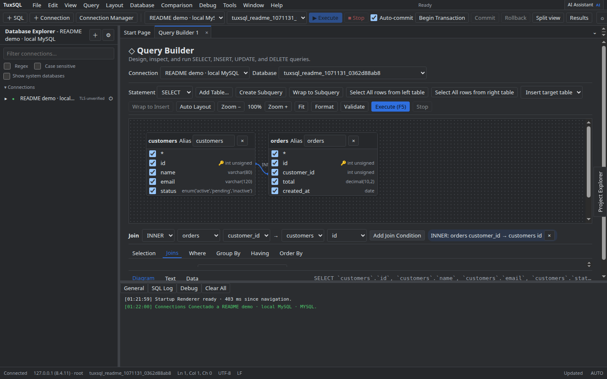
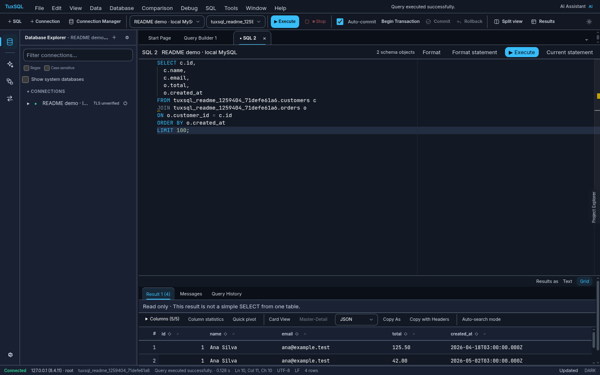
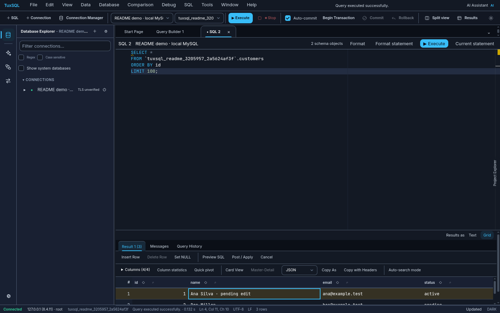
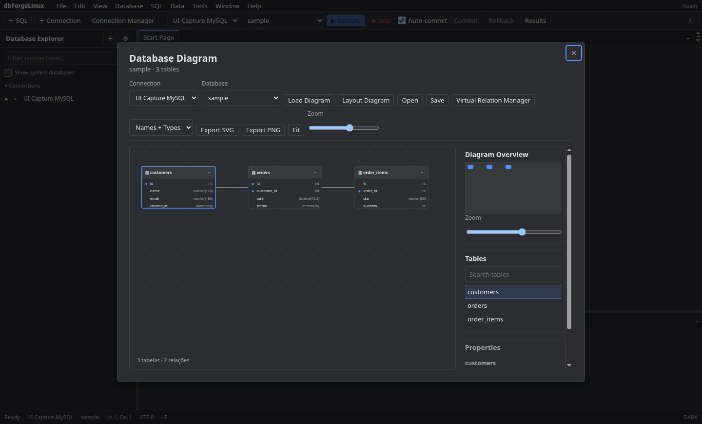
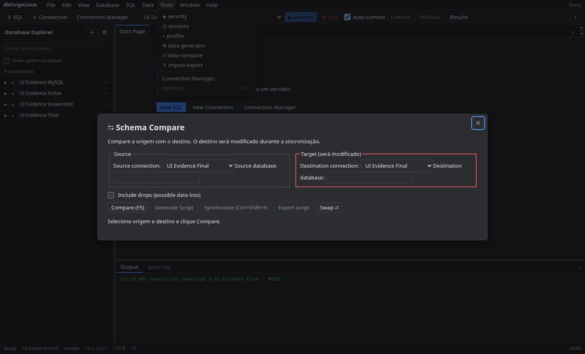
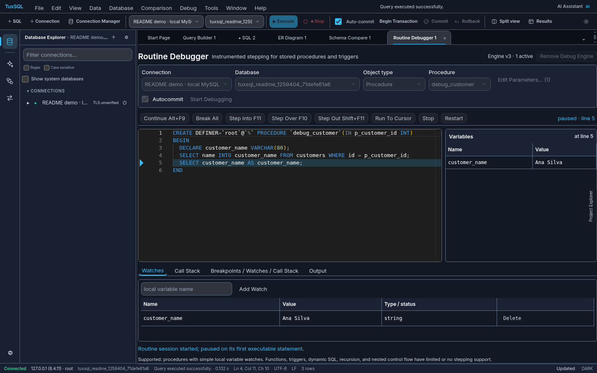
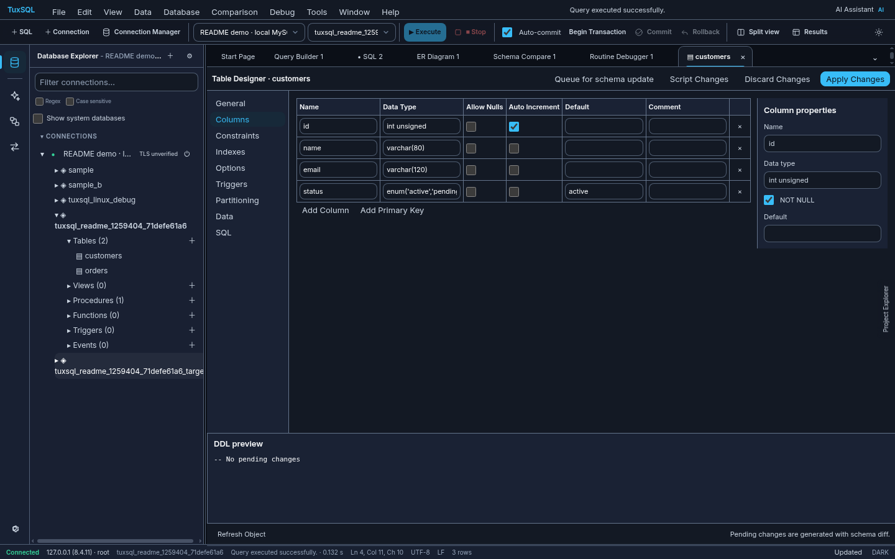
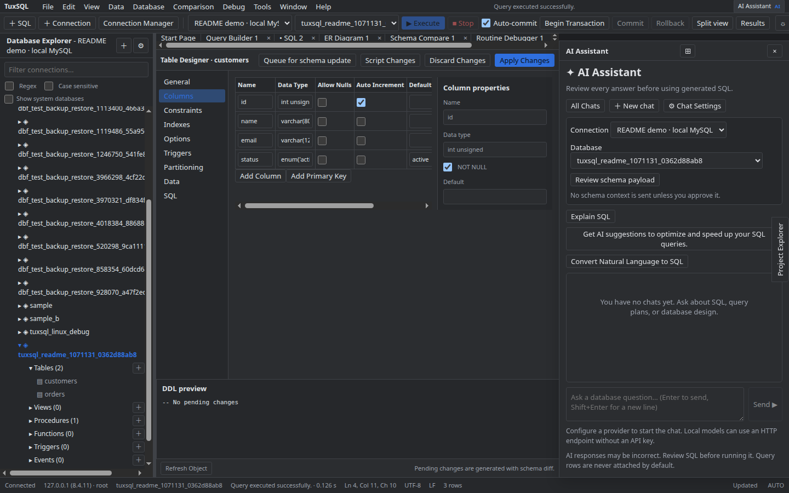

# TuxSQL

<p align="center">
  
</p>

<p align="center">
  <a href="https://github.com/danilosong/TuxSQL/actions/workflows/ci.yml"></a>
  <a href="LICENSE"></a>
  
  
  
  
  
  
</p>

<!-- PROGRESS:START -->
**Progresso do projeto** · atualizado em 2026-10-22

```text
Cobertura de funcionalidades de referência  ████████████████████  100%
Módulos implementados e testados            ████████████████████   100%  (20 de 20)
Specs de UX verificadas contra evidência    ████████████████████   100%  (20 de 20)
```

<sub>Implementação independente, não é cópia nem produto afiliado a terceiros (ver LEGAL.md). Visual v2 (shell moderno, banner de abertura de 3 s e documentação offline) entregue sem alterar nenhuma funcionalidade. O 100% vale para o escopo do produto, Linux da família Debian (Ubuntu, Pop!_OS), e para o que a referência mostrou: foi medido contra mais de 800 capturas do produto de referência feitas em VM. O que fica fora é declarado e justificado, não escondido: itens exclusivos de Windows sem adaptação viável, serviços em nuvem do fornecedor, diferenças intencionais por segurança e comportamentos que a referência não chegou a mostrar (<code>document/paridade/ESCOPO-LINUX.md</code>, <code>DIVERGENCIAS-ORIGINAL.md</code>). A revisão de segurança por ferramenta e menu está em <code>document/security-tools-matrix.md</code>. Specs de UX só contam como verificados quando citam capturas existentes.</sub>
<!-- PROGRESS:END -->

---

## Download (versão já compilada)

Baixe o instalador pronto na página de **[Releases](https://github.com/danilosong/TuxSQL/releases/latest)**, sem precisar compilar:

| Formato | Para quem | Como usar |
| --- | --- | --- |
| `tuxsql_<versão>_amd64.deb` | Ubuntu, Debian, Linux Mint, Pop!_OS | `sudo apt install ./tuxsql_<versão>_amd64.deb` |
| `tuxsql_<versão>_x86_64.AppImage` | Qualquer distribuição Linux x86_64, sem instalar | `chmod +x tuxsql_*.AppImage && ./tuxsql_*.AppImage` |

Confira a integridade com o arquivo `SHA256SUMS.txt` da release (`sha256sum -c SHA256SUMS.txt --ignore-missing`). Os binários são gerados automaticamente pelo GitHub Actions a partir de uma tag `v*`; eles ficam nas Releases e não dentro do repositório.

---

### What is TuxSQL?

> **TuxSQL** is an independent, native Linux desktop IDE and database management client for **MySQL and MariaDB**, created by **Danilo Song**. Built on **Electron, React 19, TypeScript, and the Monaco Editor**, it delivers a comprehensive development workspace tailored specifically for the Linux ecosystem. It provides professional SQL editing with autocompletion, query formatting and execution history, an interactive MDI workspace for visual query building, ER diagrams, schema & data synchronization, stored procedure stepping debugging, native SSH and HTTP tunneling, and an integrated AI Assistant with streaming and Bring-Your-Own-Key (BYOK) privacy.

> **Aviso importante / Important notice:** o TuxSQL é um projeto **independente e de código aberto**. **Não é um clone, cópia, fork ou porte do dbForge Studio**, **não é afiliado, patrocinado nem endossado pela Devart**, e não contém código, binários, ícones ou imagens dela. "dbForge" e "Devart" são marcas de seus titulares, citadas aqui apenas de forma descritiva. Veja o [Aviso Legal completo](LEGAL.md) e a seção [Aviso Legal (Disclaimer)](#aviso-legal-disclaimer).
> *TuxSQL is an independent open-source project. It is not a clone, copy, fork or port of dbForge Studio, and is not affiliated with or endorsed by Devart. See [LEGAL.md](LEGAL.md).*

---

## Visão Geral

O **TuxSQL** nasceu para preencher a carência de um ambiente integrado de desenvolvimento e administração de banco de dados no ecossistema Linux que ofereça a ergonomia, a riqueza de ferramentas e os recursos visuais tradicionalmente encontrados apenas em ferramentas comerciais para Windows.

Totalmente empacotado para distribuições baseadas em Debian/Ubuntu (`.deb`) e projetado com suporte nativo a **X11 e Wayland**, o TuxSQL combina performance de ponta com respeito absoluto à privacidade e à segurança dos dados:
- **Tudo local ou privado:** Suas credenciais são guardadas no keyring do sistema operacional (`libsecret`) com fallback em cofre cifrado em disco (AES-256-GCM).
- **Sem telemetria oculta:** Chaves de API de IA e credenciais de túnel permanecem sob total controle do desenvolvedor.
- **Arquitetura MDI genuína:** Trabalhe com múltiplos editores SQL, designers de tabelas, construtores visuais de consulta, comparadores de schema e depuradores abertos simultaneamente em abas independentes.

---

## Galeria de Recursos

Abaixo estão capturas reais da interface gráfica do TuxSQL executando em ambiente Linux x86_64 nos temas Claro e Escuro:

### 1. Ambiente Integrado e Construtor Visual (MDI Shell & Query Builder)

| Tema Claro | Tema Escuro |
|---|---|
|  |  |

### 2. Editor SQL com Monaco e Grade de Resultados (SQL Editor & Result Grid)

| Tema Claro | Tema Escuro |
|---|---|
|  |  |

### 3. Edição Direta de Células na Grade (Inline Data Grid Editing)

| Tema Claro | Tema Escuro |
|---|---|
|  |  |

### 4. Modelagem e Diagrama de Entidade-Relacionamento (ER Diagram)

| Tema Claro | Tema Escuro |
|---|---|
|  |  |

### 5. Comparação e Sincronização de Schemas (Schema Compare)

| Tema Claro | Tema Escuro |
|---|---|
|  |  |

### 6. Depurador de Stored Procedures Passo a Passo (Routine Debugger)

| Tema Claro | Tema Escuro |
|---|---|
|  |  |

### 7. Designer Visual de Tabelas e DDL (Table Designer)

| Tema Claro | Tema Escuro |
|---|---|
|  |  |

### 8. Assistente de IA Acoplado com Chave Própria (AI Assistant Dock)

| Tema Claro | Tema Escuro |
|---|---|
|  |  |

---

## Funcionalidades por Módulo

| Módulo / Recurso | Descrição | Destaques e Capacidades |
|---|---|---|
| **SQL Editor** | Editor SQL completo baseado no motor Monaco | Autocompletion contextual de tabelas/colunas, snippets SQL expansíveis, formatador com regras estritas, histórico persistente de execução e paginação em spool de disco para grandes volumes. |
| **Database Explorer** | Árvore navegável de objetos de metadados | Inspeção hierárquica de conexões, bancos, tabelas, colunas, chaves, índices, views, procedures, functions, triggers e eventos. Filtro dinâmico de objetos e alternância de bases do sistema. |
| **Data Grid & Viewer** | Grade de dados virtualizada com paginação | Suporte a milhões de linhas via spool local, visualizador em modal para campos JSON/texto longo, exportação rápida e edição de células com suporte a buffer de modificações pendentes. |
| **Inline Grid Editing** | Edição in-place direta na grade de dados | Destaque visual por cores para inserções, alterações e deleções pendentes. Geração segura de DML com conferência de chave primária/única antes de aplicar no servidor. |
| **Table Designer** | Designer gráfico para criação e alteração de tabelas | Gestão visual de colunas, tipos de dados, flags (Null, Auto-increment), índices, chaves estrangeiras, opções de engine, particionamento e prévia dinâmica do DDL gerado via diff. |
| **Editores de Objetos** | IDE especializada para rotinas e componentes lógicos | Editores dedicados com syntax highlighting para Stored Procedures, Stored Functions, Views, Triggers e Events, com comandos rápidos de execução de teste e alteração estrutural. |
| **Import / Export Wizard** | Assistente multifórmato de migração de dados | Importação e exportação de dados com mapeamento flexível de colunas para formatos: CSV, Excel (.xlsx), XML, JSON, HTML e scripts SQL INSERT. Suporte a templates de exportação reutilizáveis. |
| **Schema Compare** | Comparador estrutural e sincronizador de bancos | Análise comparativa completa de objetos entre bancos de dados ou conexões diferentes. Geração de scripts DDL de sincronização com preview side-by-side de diferenças. |
| **Data Compare** | Comparador de conteúdo de dados | Confronto linha a linha de tabelas homônimas com base em chaves de comparação. Resumo de registros idênticos, divergentes, exclusivos da origem e exclusivos do destino. |
| **Query Builder** | Construtor visual de consultas em aba MDI | Interface visual em aba de documento para elaboração de consultas SELECT, INSERT, UPDATE e DELETE. Seleção interativa de colunas, agrupamentos, filtros WHERE/HAVING e subconsultas. |
| **Diagrama ER** | Visualizador de Entidade-Relacionamento (.dbd) | Geração de diagramas esquemáticos a partir de chaves estrangeiras reais e relações virtuais. Navegação panorâmica, controle de zoom, busca de objetos e exportação vetorial em SVG e PNG. |
| **Security Manager** | Gestão de contas de usuários e privilégios | Criação, duplicação e remoção de usuários de banco de dados, definição de hosts permitidos, regras de expiração de senhas, limites de recursos e concessão granular de privilégios. |
| **Session Manager** | Monitoramento e controle de sessões do servidor | Listagem de conexões ativas com estados de bloqueio, tempo decorrido e consulta em execução. Filtro de sessões próprias/em sleep, cancelamento seguro (`KILL QUERY` / `KILL CONNECTION`) e inspeção de variáveis globais. |
| **Query Profiler** | Análise e diagnóstico de desempenho de queries | Captura de tempos de execução (duração, CPU, I/O), visualização de árvores de plano de execução (EXPLAIN JSON), variação de variáveis de status da sessão e histórico de perfis para comparação. |
| **Data Generator** | Gerador de dados de teste sintéticos (.dgen) | População automatizada de tabelas com dados de teste. Geradores pré-configurados para nomes, emails, endereços, datas, sequências, listas customizadas e expressões regulares (regex). |
| **Database Documenter** | Gerador automatizado de documentação (.ddoc) | Compilação de documentação detalhada de esquemas e dicionários de dados para formatos HTML estruturado, Markdown e relatórios PDF, com inclusão opcional do diagrama de relacionamentos. |
| **Routine Debugger** | Depurador passo a passo de Stored Procedures | Motor de depuração instrumentada para procedimentos armazenados MySQL/MariaDB: execução passo a passo (Step Into, Step Over, Step Out), breakpoints, inspeção dinâmica de variáveis locais (Watches) e pilha de chamadas (Call Stack). |
| **Source Control (Git)** | Versionamento de schema integrado com Git | Integração com repositórios Git locais: commit de alterações de schema com seleção granular de scripts DDL, visualização de diffs de código, troca e criação de branches e checkout limpo. |
| **Data Report & Pivot** | Relatórios tabulares e tabelas dinâmicas | Construção de agregações multidimensionais de resultados de consultas (Pivot Tables) com gráficos em barra e exportação de sumários gerenciais. |
| **AI Assistant** | Assistente de IA integrado em dock lateral | Chat inteligente para conversão de linguagem natural em SQL, explicação de queries complexas, otimização e sugestão de índices. Suporte a OpenAI, Anthropic e modelos locais via Ollama com streaming e chave própria (BYOK). |
| **Code Analysis** | Análise estática de código SQL | Verificação estática de boas práticas, riscos de performance (ex: predicados que impedem uso de índice) e regras de estilo conforme diretrizes de código SQL. |
| **Conectividade Segura** | Túneis de rede SSH e HTTP nativos | Conexão com servidores remotos e bancos protegidos por firewall via túnel SSH criptografado (chave pública/privada com passphrase) ou script de túnel web HTTP (`tunnel.php`). |
| **Service Control** | Controle de serviços MySQL/MariaDB locais | Painel administrativo para checar status, iniciar, parar e reiniciar serviços de banco locais gerenciados pelo `systemd` do Linux, sem exigência de sudo direto pelo app. |
| **Backup & Restore** | Ferramentas auxiliares de banco | Geração de dumps de schema e dados em arquivos `.sql`, restauração orientada com prévia de script e cópia direta de esquemas entre conexões ativas. |
| **Opções e Atalhos** | Central de preferências e keymap configurável | Configuração de comportamento de inicialização, salvamento automático de rascunhos, esquemas de atalhos de teclado (padrão VS Code ou esquema alternativo de atalhos familiar a usuários de IDEs de banco de dados), fontes e temas visuais (Auto, Claro, Escuro e Alto Contraste). |
| **Internacionalização** | Suporte multilíngue completo | Chaveamento nativo em tempo de execução entre **Inglês (en)** e **Português do Brasil (pt-BR)** para todas as telas, botões, mensagens e diálogos. |

---

## Instalação e Execução

### Pacote Debian (.deb)

Para instalar o pacote oficial no Ubuntu, Debian, Linux Mint ou Pop!_OS:

```bash
# Instalação do pacote .deb (substitua pelo caminho do arquivo baixado ou gerado)
sudo apt install /caminho/para/tuxsql_0.1.2_amd64.deb
```

Após a instalação, o aplicativo estará disponível no menu do sistema como **TuxSQL** ou pode ser iniciado via terminal:

```bash
tuxsql
```

Para abrir diretamente um arquivo SQL do terminal:

```bash
tuxsql ~/queries/analise.sql
```

### Execução a partir do Código-Fonte (Modo Desenvolvedor)

Requisitos: **Node.js 22+**, **pnpm 10+**, **Git**.

```bash
# 1. Clonar o repositório
git clone https://github.com/danilosong/TuxSQL.git
cd TuxSQL/app

# 2. Habilitar o pnpm e instalar dependências
corepack enable
pnpm install --frozen-lockfile

# 3. Iniciar em modo de desenvolvimento (hot-reload)
pnpm dev
```

#### Execução em Servidores Sem Monitor (Headless / Xvfb)

Para executar o app em ambientes CI ou servidores Linux remotos sem display físico:

```bash
cd app
env -u DISPLAY -u WAYLAND_DISPLAY -u XDG_SESSION_TYPE xvfb-run -a pnpm dev
```

---

## Requisitos de Sistema

- **Sistema Operacional:** Linux x86_64 (amd64). Veja a [compatibilidade de distribuições](#compatibilidade-de-distribuições-linux) abaixo para o que foi testado.
- **Servidor Gráfico:** X11 nativo ou Wayland (via XWayland ou flags do Chromium).
- **Dependências Nativas do Sistema:**
  - `libsecret-1-0` (para integração com o chaveiro GNOME Keyring / KWallet).
  - Bibliotecas gráficas básicas do Electron: `libnss3`, `libatk1.0-0`, `libgtk-3-0`, `libasound2`.
- **Servidores de Banco Suportados:**
  - **MySQL:** 5.7.x, 8.0.x, 8.4.x LTS.
  - **MariaDB:** 10.11.x LTS, 11.x.

---

## Compatibilidade de Distribuições Linux

A coluna **Situação** separa o que foi **verificado de verdade** do que é apenas **esperado**. Não declaramos suporte sem teste.

| Distribuição | Formato | Situação |
|---|---|---|
| Ubuntu 24.04 LTS | `.deb` | ✅ **Testada:** instalação limpa em contêiner (`dpkg -c`, `ldd`, início sob Xvfb) e smoke e2e contra o pacote |
| Ubuntu 26.04 | `.deb` e código-fonte | ✅ **Testada:** ambiente de desenvolvimento (uso diário do app) |
| Ubuntu 22.04 LTS, Debian 12+, Linux Mint 21+, Pop!_OS 22.04+, elementary OS 7+ | `.deb` | 🟡 **Esperada:** mesma família e mesmas dependências; ainda sem teste dedicado |
| Fedora, openSUSE, Arch Linux, Manjaro e outras | AppImage ou código-fonte | 🟡 **Esperada:** sem `.deb`; use o AppImage da release ou `pnpm dev`; ainda sem teste dedicado |
| Ubuntu 20.04 e anteriores, Debian 11 e anteriores | — | ❌ **Não verificada:** o Electron 38 exige uma glibc mais recente; provavelmente não funciona |

**Detalhes que valem saber:**

- **Arquitetura:** somente `amd64` por enquanto (sem pacotes ARM).
- **Servidor gráfico:** X11 e Wayland.
- **Chaveiro:** com `libsecret` as senhas usam o chaveiro do sistema; sem ele, ficam num cofre local cifrado (AES-256-GCM) com aviso visível, nunca em texto puro.
- **Dependências do `.deb`:** `libgtk-3-0`, `libnotify4`, `libnss3`, `libxss1`, `libxtst6`, `xdg-utils`, `libatspi2.0-0`, `libuuid1`, `libsecret-1-0`, `libasound2t64` ou `libasound2`, `libgbm1`.
- **Snap e Flatpak:** não são fornecidos.
- Testou em outra distribuição? Abra uma issue com a distro, a versão e o resultado; ela passa para a tabela acima.

---

## Como Testar e Validar

A suíte de testes do TuxSQL abrange testes unitários, validações de contrato IPC, testes de estresse de streaming e testes de integração com instâncias reais de MySQL e MariaDB.

Executando a partir da pasta `app/`:

```bash
cd app

# 1. Verificação estática de tipos (TypeScript)
pnpm typecheck

# 2. Verificação de estilo e conformidade de código (ESLint)
pnpm lint

# 3. Testes unitários (Vitest - mais de 140 testes cobrindo módulos isolados)
pnpm test

# 4. Benchmark de performance (spool de memória e tempo de parsing)
pnpm perf:benchmark

# 5. Build dos binários de produção
pnpm build

# 6. Empacotamento do instalador Debian (.deb)
pnpm dist:deb
```

### Testes de Integração com Banco Descartável (Docker)

Para rodar a suíte completa contra servidores reais:

```bash
cd app

# Sobe os contêineres MySQL 8.4 e MariaDB 11 isolados
docker compose -f test/docker-compose.yml up -d --wait

# Executa os testes de integração contra a porta de teste
MYSQL_INTEGRATION=1 pnpm test

# Executa o teste de fumaça E2E com Playwright + Electron em Xvfb
pnpm smoke:e2e

# Finaliza e destrói o ambiente de teste
docker compose -f test/docker-compose.yml down -v
```

---

## Arquitetura do Software

O TuxSQL segue o padrão de segurança e isolamento de processos recomendado pelo Electron:

```
├── app/src/main/               # Processo Principal (Node.js)
│   ├── db/                     # Drivers de conexão (mysql2 core pool, streaming, túneis SSH/HTTP)
│   ├── connections/            # Armazenamento e ciclo de vida de conexões
│   ├── security/               # PasswordVault (libsecret + AES-256-GCM) e WindowPolicy
│   ├── ipc/                    # Handlers IPC com validação de schemas e IPC Guard
│   └── index.ts                # Inicialização da janela principal e ciclo de vida do Electron
│
├── app/src/preload/            # Camada de Pré-carregamento (Context Isolation)
│   ├── api/                    # APIs tipadas expostas de forma segura ao renderer
│   └── index.ts                # contextBridge.exposeInMainWorld('tuxsql', ...)
│
├── app/src/renderer/           # Processo de Renderização (React 19 + Monaco)
│   ├── src/ui/                 # Shell da aplicação, painéis MDI, diálogos e componentes
│   ├── src/i18n/               # Motor de internacionalização reativo (en / pt-BR)
│   └── src/main.tsx            # Ponto de entrada React montado na janela
│
└── app/src/modules/            # Módulos de Domínio Puros (Isolados e Testáveis)
    ├── schema/                 # Introspecção, DDL e motor de comparação de schemas
    ├── editor/                 # Motor de autocompletar, snippets e formatação SQL
    ├── query-builder/          # Parser e compilador de modelo para SQL
    ├── routine-debugger/       # Instrumentação de código SQL para depuração passo a passo
    ├── ai-assistant/           # Cliente de IA, sanitização de contexto e streaming
    ├── data-export-import/     # Encoders e decoders de arquivos (CSV, Excel, XML, JSON)
    └── grid-editing/           # Detecção de deltas e geração de DML para edição de grade
```

### Blindagem de Segurança e IPC Guard

- **IPC Guard Central (`app/src/main/ipc/guard.ts`):** Todas as chamadas entre a UI e o processo principal são validadas contra esquemas estritos. Mensagens com payloads malformados ou origens de frame desconhecidas são rejeitadas sumariamente.
- **Operações Críticas com Confirmação Mandatória:** Operações destrutivas (`DROP`, `KILL QUERY`, restore de banco e resets) requerem confirmação explícita do usuário, impedindo acionamentos silenciosos.
- **Cofre Seguro de Credenciais:** As senhas nunca trafegam em texto puro nos logs e são cifradas via `libsecret` do Linux, com fallback criptografado isolado nas pastas de dados do usuário (`$XDG_DATA_HOME`).
- **Segurança da IA:** A comunicação com provedores de IA remotos exige estritamente HTTPS e limita o tráfego a metadados do schema. Dados de linhas de tabelas nunca são enviados sem consentimento prévio do usuário.

Para detalhes completos da auditoria, consulte o relatório independente em [document/security-review.md](document/security-review.md).

---

## Compatibilidade de Banco de Dados

A compatibilidade foi verificada com testes de integração contínua contra servidores reais em contêineres descartáveis:

| Servidor | Versão Validada | Status da Suíte de Testes |
|---|---|---|
| **MySQL** | `5.7.44` | ✓ 48 arquivos de teste, 147 testes aprovados |
| **MySQL** | `8.0.46` | ✓ 48 arquivos de teste, 147 testes aprovados |
| **MySQL LTS** | `8.4.11` | ✓ 48 arquivos de teste, 148 testes aprovados |
| **MariaDB LTS** | `10.11.19` | ✓ 48 arquivos de teste, 148 testes aprovados |
| **MariaDB** | `11.8.9` | ✓ 48 arquivos de teste, 148 testes aprovados |

Para o registro detalhado de comportamento de handshakes TLS e fallbacks, veja [document/compat.md](document/compat.md).

---

## Estado do Projeto e Paridade (Declaração Honesta)

O TuxSQL é um projeto de código aberto em desenvolvimento ativo.

- **O que está feito:** Todos os 18 módulos listados no inventário inicial de engenharia reversa estão implementados no código e contam com cobertura de testes unitários, testes de integração e evidências visuais registradas.
- **O que NÃO afirmamos:** **Não afirmamos paridade formal ou funcional certificada com nenhum produto comercial**, em especial com o dbForge Studio for MySQL da Devart, que serviu apenas como referência de *categoria de funcionalidades* (o que uma boa IDE de banco de dados oferece). As implementações são **código original**, escritas a partir de especificações próprias do projeto e de observação de comportamento, **sem uso de código, binários ou recursos do produto de referência**. Os desvios conhecidos estão documentados na [Matriz de Paridade](document/03-matriz-paridade.md).

---

## Limitações Conhecidas

Para total transparência com os usuários e a comunidade de desenvolvimento:

1. **Depurador de Rotinas:** O mecanismo de debugging funciona exclusivamente com **Stored Procedures** por meio de injeção temporária de código de instrumentação e variáveis de sessão. Não há suporte a depuração passo a passo de Stored Functions, Triggers ou comandos dinâmicos `PREPARE/EXECUTE`.
2. **Edição Direta na Grade:** A edição inline de células no Result Grid é suportada apenas em consultas simples do tipo `SELECT * FROM tabela` sobre uma única tabela que possua **chave primária (PK) ou índice com constraint UNIQUE**. Consultas complexas com `JOIN`, subqueries, agregações (`GROUP BY`) ou colunas calculadas operam em modo somente-leitura.
3. **Formatos e Serviços Fora de Escopo:** O TuxSQL foi desenvolvido exclusivamente para ecossistemas modernos e abertos em Linux. Funcionalidades legadas de ecossistemas Windows (como importação/exportação direta para Microsoft Access, drivers genéricos ODBC de 32 bits, conectores Google Sheets legados, e integração com servidores de versão descontinuados como Team Foundation Server/TFS e Mercurial/Hg) estão expressamente fora do escopo do projeto.

---

## Documentação Adicional

- [Guia do Usuário por Módulo](document/user-guide/README.md)
- [Matriz de Paridade de Recursos](document/03-matriz-paridade.md)
- [Relatório de Revisão de Segurança](document/security-review.md)
- [Matriz de Compatibilidade MySQL/MariaDB](document/compat.md)
- [Aviso Legal e Propriedade Intelectual](LEGAL.md)
- [Como Contribuir](CONTRIBUTING.md)
- [Histórico de Versões (Changelog)](CHANGELOG.md)

---

## Aviso Legal (Disclaimer)

**TuxSQL** é um software livre de código aberto (licença MIT) e de desenvolvimento independente, criado por **Danilo Song** e mantido pela comunidade.

- **Não é um clone.** É uma implementação independente, para Linux, de funcionalidades comuns a IDEs de banco de dados. Funcionalidades, ideias, métodos e algoritmos não são protegidos por direito autoral; a *expressão* (código, imagens, textos, identidade visual) é, e **nada disso foi copiado** (Lei nº 9.609/1998, art. 2º e art. 6º, III; Lei nº 9.610/1998, art. 8º).
- Este projeto **não é afiliado, associado, autorizado, patrocinado ou de qualquer forma oficialmente conectado à Devart** ou a qualquer uma de suas subsidiárias ou afiliadas.
- O código-fonte, componentes, folhas de estilo e recursos visuais deste repositório foram criados do zero para este projeto; **nenhum código-fonte proprietário, biblioteca fechada, binário, ícone, imagem ou texto de ajuda pertencente ao dbForge Studio foi copiado ou incluído neste repositório**. Materiais extraídos de outros produtos não são versionados nem distribuídos.
- As capturas de tela deste README mostram **exclusivamente o TuxSQL**.
- *dbForge*, *dbForge Studio* e *Devart* são marcas de seus legítimos titulares, sem qualquer direito reivindicado aqui. Aparecem apenas de forma **nominativa e descritiva** (Lei nº 9.279/1996, art. 132), para informar a relação de equivalência de funcionalidades e a ausência de vínculo.
- **Titulares de direitos:** se achar que algo aqui viola seus direitos, abra uma issue ou contate o mantenedor; o conteúdo será analisado e, havendo fundamento, removido ou substituído, inclusive com renomeação do projeto. Detalhes em [LEGAL.md](LEGAL.md).
- Este texto não é aconselhamento jurídico. O software é fornecido "como está", sem garantias (veja o [`LICENSE`](LICENSE)).

*English:* TuxSQL is an independent MIT-licensed project. It is not a clone or derivative of dbForge Studio, contains none of its code or assets, and is not affiliated with, sponsored or endorsed by Devart. Trademarks belong to their owners and are mentioned only descriptively. Rights holders may contact the maintainer to request review or removal (see [LEGAL.md](LEGAL.md)).

---

<p align="center">
  Desenvolvido com dedicação para a comunidade de desenvolvedores e administradores de banco de dados Linux.
</p>
