<p align="center">
  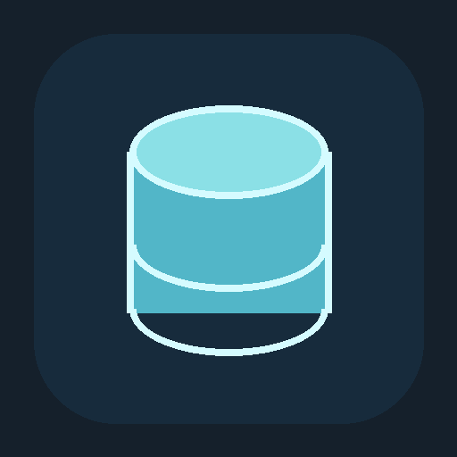
</p>

<h1 align="center">TuxSQL</h1>

<p align="center">
  <b>IDE de banco de dados para MySQL e MariaDB, feita para o Linux.</b><br>
  Editor SQL, grade de dados, designer de tabelas, diagrama ER, comparação de schemas e dados,<br>
  depurador de procedures e assistente de IA num app desktop nativo. Código aberto, local e seu.
</p>

<p align="center">
  <a href="LICENSE"></a>
  
  
  <br>
  
  
  
  
  
</p>

<p align="center">
  <a href="https://github.com/danilosong/TuxSQL/releases/latest"></a>
</p>

<p align="center">
  <picture>
    <source media="(prefers-color-scheme: dark)" srcset="document/evidence/ui/ui-corrections-dark.png">
    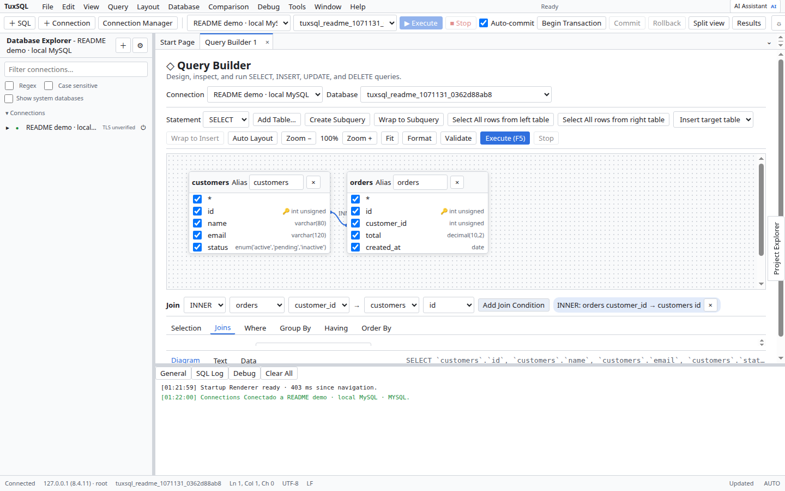
  </picture>
  <br>
  <sub>Shell MDI com Database Explorer, Query Builder e grade de resultados. As imagens seguem o tema claro ou escuro do seu GitHub.</sub>
</p>

<p align="center">
  <a href="#funcionalidades">Funcionalidades</a> ·
  <a href="#tudo-o-que-vem-incluído">Tudo incluído</a> ·
  <a href="#segurança-em-primeiro-lugar">Segurança</a> ·
  <a href="#por-dentro">Por dentro</a> ·
  <a href="#download">Download</a> ·
  <a href="#primeiros-passos">Primeiros passos</a> ·
  <a href="#testes">Testes</a> ·
  <a href="#documentação">Documentação</a> ·
  <a href="#aviso-legal-disclaimer">Aviso legal</a>
</p>

<!-- PROGRESS:START -->
**Progresso do projeto** · atualizado em 2026-10-24

```text
Cobertura de funcionalidades de referência  ████████████████████  100%
Módulos implementados e testados            ████████████████████   100%  (20 de 20)
Specs de UX verificadas contra evidência    ████████████████████   100%  (20 de 20)
```

<sub>Implementação independente, não é cópia nem produto afiliado a terceiros (ver LEGAL.md). Visual v2 (shell moderno, banner de abertura de 3 s e documentação offline) entregue sem alterar nenhuma funcionalidade; README reorganizado em 2026-10-23 e nova identidade visual em 2026-10-24 (ícone e arte da splash em grafite neon), sem mudança de funcionalidade. O 100% vale para o escopo do produto, Linux da família Debian (Ubuntu, Pop!_OS), e para o que a referência mostrou: foi medido contra mais de 800 capturas do produto de referência feitas em VM. O que fica fora é declarado e justificado, não escondido: itens exclusivos de Windows sem adaptação viável, serviços em nuvem do fornecedor, diferenças intencionais por segurança e comportamentos que a referência não chegou a mostrar (<code>document/paridade/ESCOPO-LINUX.md</code>, <code>DIVERGENCIAS-ORIGINAL.md</code>). A revisão de segurança por ferramenta e menu está em <code>document/security-tools-matrix.md</code>. Specs de UX só contam como verificados quando citam capturas existentes.</sub>
<!-- PROGRESS:END -->

> [!NOTE]
> **O TuxSQL é independente.** Não é clone, cópia, fork ou porte do dbForge Studio, não é afiliado à Devart e não contém código, binários, ícones ou imagens dela. Veja o [Aviso Legal](#aviso-legal-disclaimer) e o [LEGAL.md](LEGAL.md).
> *TuxSQL is an independent open-source project, not affiliated with or endorsed by Devart.*

<br>

<table>
  <tr>
    <td width="25%" valign="top">
      <h3>🐧 Feito para Linux</h3>
      Pacote <code>.deb</code> e AppImage, X11 e Wayland, senhas no chaveiro do sistema (<code>libsecret</code>) e serviços locais controlados pelo <code>systemd</code>.
    </td>
    <td width="25%" valign="top">
      <h3>🧰 IDE completa</h3>
      20 módulos num só lugar: do editor SQL ao depurador de procedures, passando por comparação, geração de dados, relatórios e Git.
    </td>
    <td width="25%" valign="top">
      <h3>🔐 Seguro por padrão</h3>
      Guard de IPC com schemas, confirmação em toda operação destrutiva, cofre cifrado (AES-256-GCM) e nenhuma telemetria.
    </td>
    <td width="25%" valign="top">
      <h3>🤖 IA com sua chave</h3>
      Assistente com streaming para OpenAI, Anthropic ou Ollama local. Só metadados do schema saem da máquina sem seu consentimento.
    </td>
  </tr>
</table>

<br>

## Funcionalidades

Todas as capturas abaixo são do TuxSQL rodando em Linux x86_64. Elas mudam de tema junto com o seu GitHub (claro ou escuro).

<table>
  <tr>
    <td width="50%" valign="top">
      <picture>
        <source media="(prefers-color-scheme: dark)" srcset="document/evidence/ui/sql-editor-dark.png">
        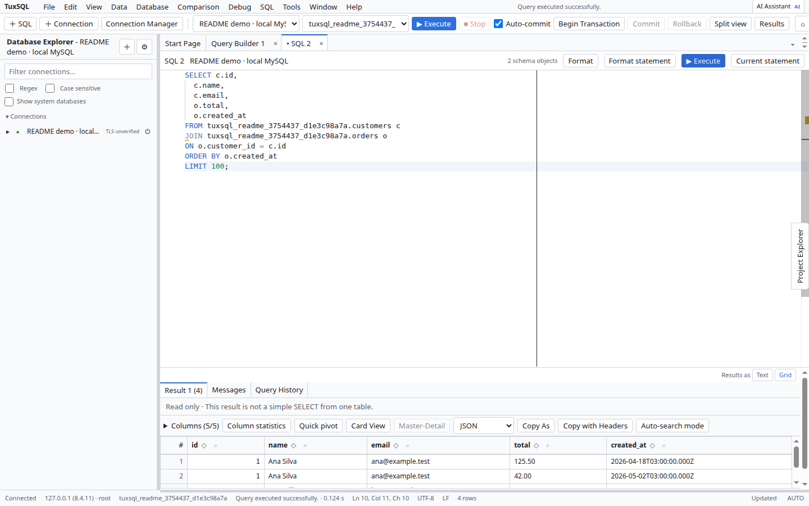
      </picture>
      <h3>Escreva SQL sem atrito</h3>
      Editor baseado no Monaco com autocomplete de tabelas e colunas, snippets, formatador, auto-maiúsculas, execução por seleção ou por statement e histórico persistente.
      <br><br>
      Resultados grandes vão para um spool em disco, então milhões de linhas paginam sem travar a janela.
    </td>
    <td width="50%" valign="top">
      <picture>
        <source media="(prefers-color-scheme: dark)" srcset="document/evidence/ui/table-data-grid-edit-dark.png">
        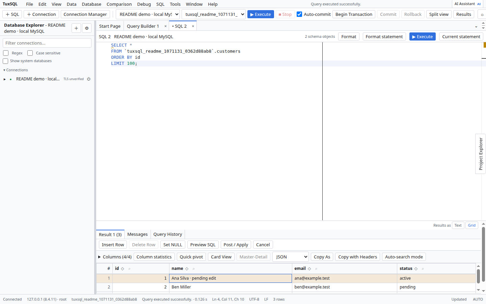
      </picture>
      <h3>Edite dados direto na grade</h3>
      Inserções, alterações e exclusões ficam destacadas por cor até você aplicar. O DML é gerado a partir da chave primária ou única, com detecção de conflito otimista.
      <br><br>
      Master-Detail, Card View, Data Viewer para JSON e textos longos, e cópia em vários formatos.
    </td>
  </tr>
  <tr>
    <td width="50%" valign="top">
      <picture>
        <source media="(prefers-color-scheme: dark)" srcset="document/evidence/ui/table-designer-dark.png">
        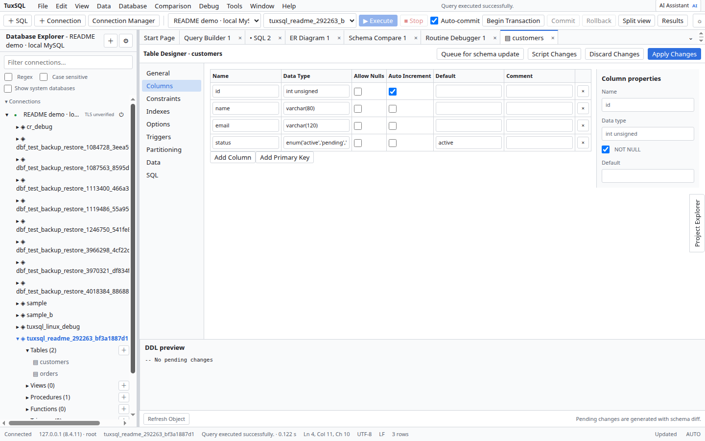
      </picture>
      <h3>Desenhe tabelas visualmente</h3>
      Colunas, tipos, índices, chaves estrangeiras, engine e particionamento, com prévia do DDL gerada por diff. Editores dedicados para views, procedures, functions, triggers e events.
    </td>
    <td width="50%" valign="top">
      <picture>
        <source media="(prefers-color-scheme: dark)" srcset="document/evidence/ui/er-diagram-dark.png">
        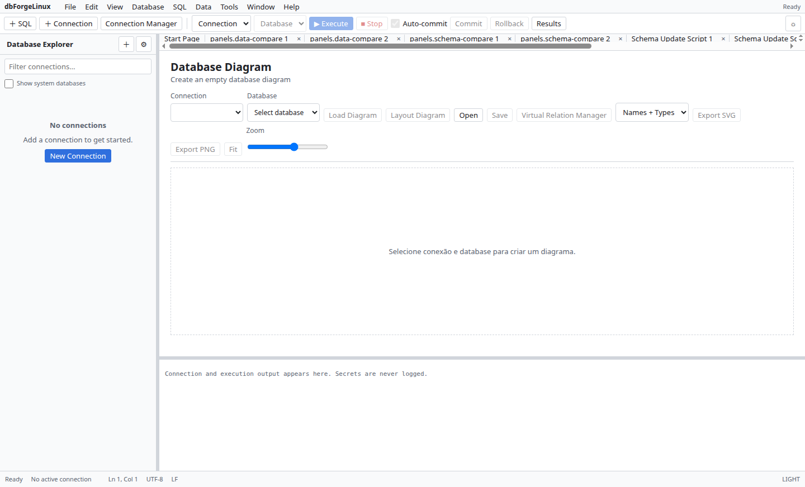
      </picture>
      <h3>Veja o modelo inteiro</h3>
      Diagramas ER a partir das chaves estrangeiras reais e de relações virtuais, com zoom, busca, arraste a partir do Explorer e exportação em SVG e PNG.
    </td>
  </tr>
  <tr>
    <td width="50%" valign="top">
      <picture>
        <source media="(prefers-color-scheme: dark)" srcset="document/evidence/ui/schema-compare-dark.png">
        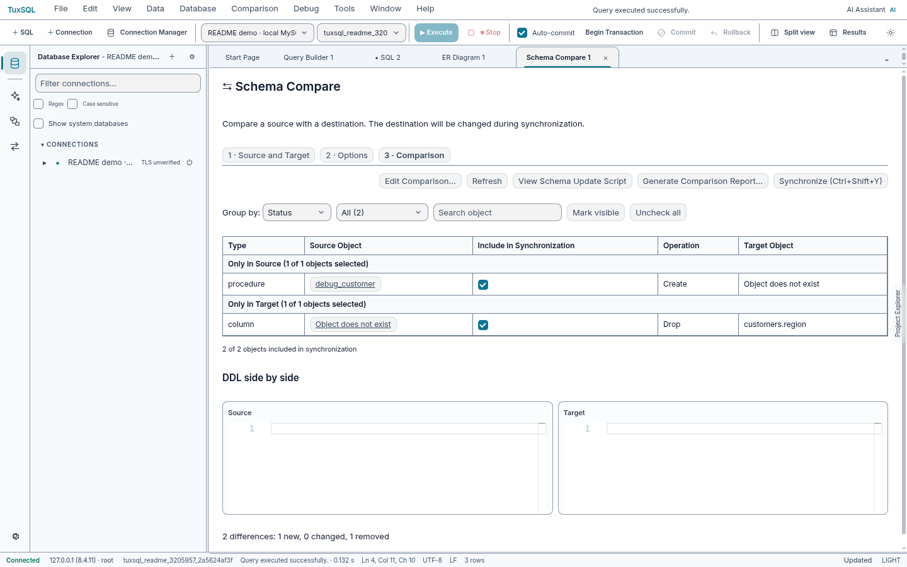
      </picture>
      <h3>Compare e sincronize</h3>
      Schema Compare e Data Compare entre bancos, pastas de scripts e snapshots, com diff lado a lado e script de sincronização aplicado em transação, sempre com confirmação.
    </td>
    <td width="50%" valign="top">
      <picture>
        <source media="(prefers-color-scheme: dark)" srcset="document/evidence/ui/routine-debugger-dark.png">
        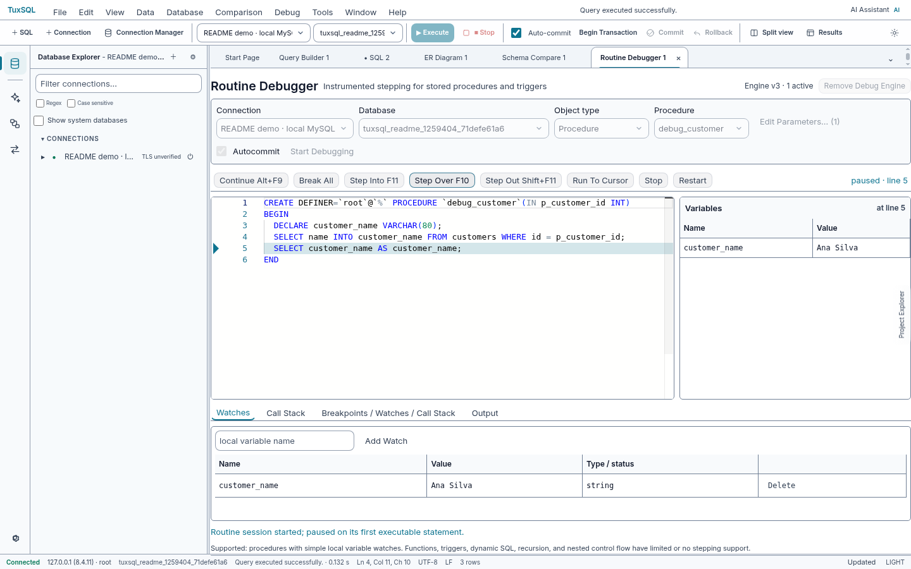
      </picture>
      <h3>Depure procedures passo a passo</h3>
      Step Into, Step Over e Step Out, breakpoints, watches de variáveis locais e pilha de chamadas para stored procedures de MySQL e MariaDB.
    </td>
  </tr>
  <tr>
    <td width="50%" valign="top">
      <picture>
        <source media="(prefers-color-scheme: dark)" srcset="document/evidence/ui/query-builder-joins-dark.png">
        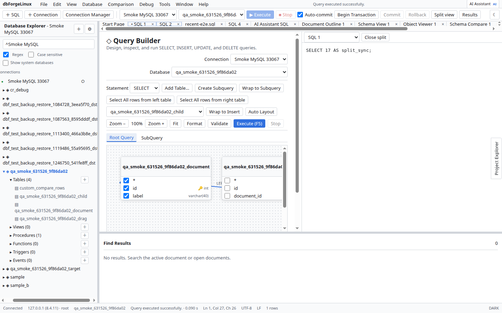
      </picture>
      <h3>Monte consultas sem digitar</h3>
      Query Builder em aba de documento: joins por arraste, colunas, agrupamentos, filtros WHERE e HAVING e subconsultas, para SELECT, INSERT, UPDATE e DELETE.
    </td>
    <td width="50%" valign="top">
      <picture>
        <source media="(prefers-color-scheme: dark)" srcset="document/evidence/ui/ai-assistant-dark.png">
        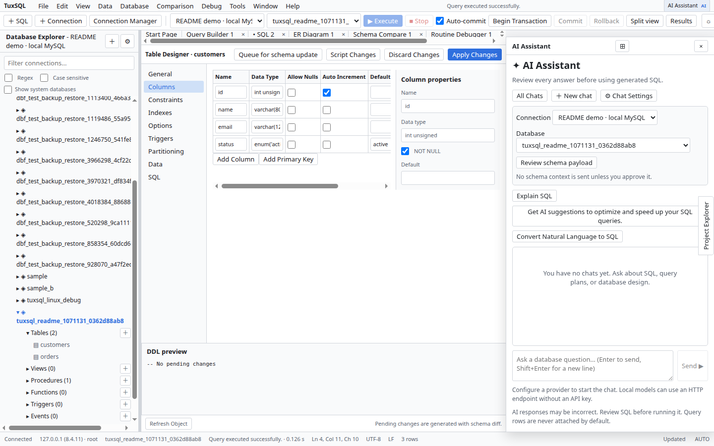
      </picture>
      <h3>Pergunte em linguagem natural</h3>
      O assistente de IA transforma perguntas em SQL, explica e otimiza consultas e sugere índices. Funciona com OpenAI, Anthropic ou modelos locais via Ollama, sempre com a sua chave.
    </td>
  </tr>
</table>

<details>
<summary><b>Mais capturas</b> (Data Generator, Pivot, Profiler, Source Control, Import/Export, Sessões)</summary>
<br>

| | |
|---|---|
| 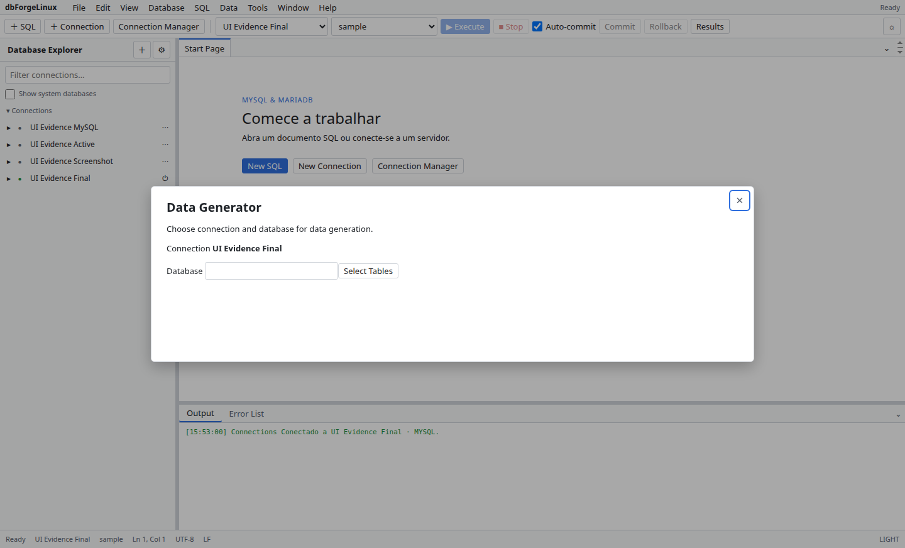 | 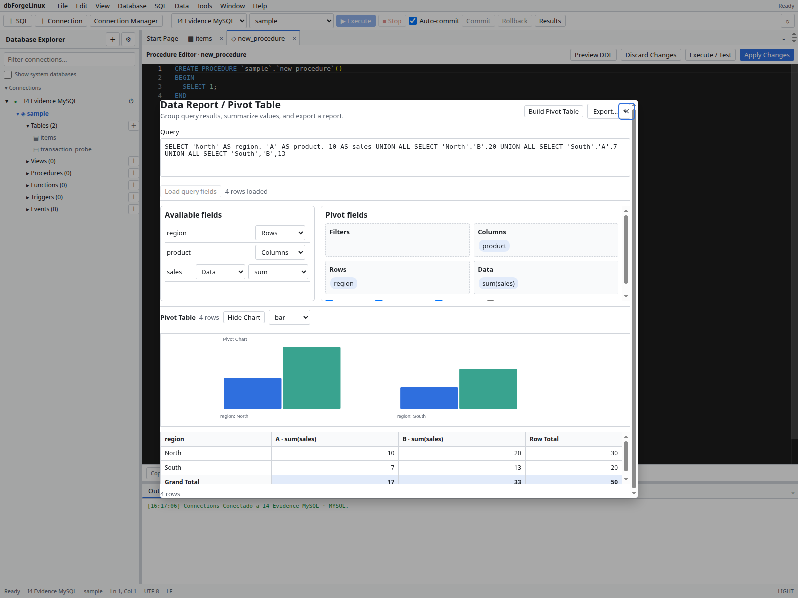 |
| 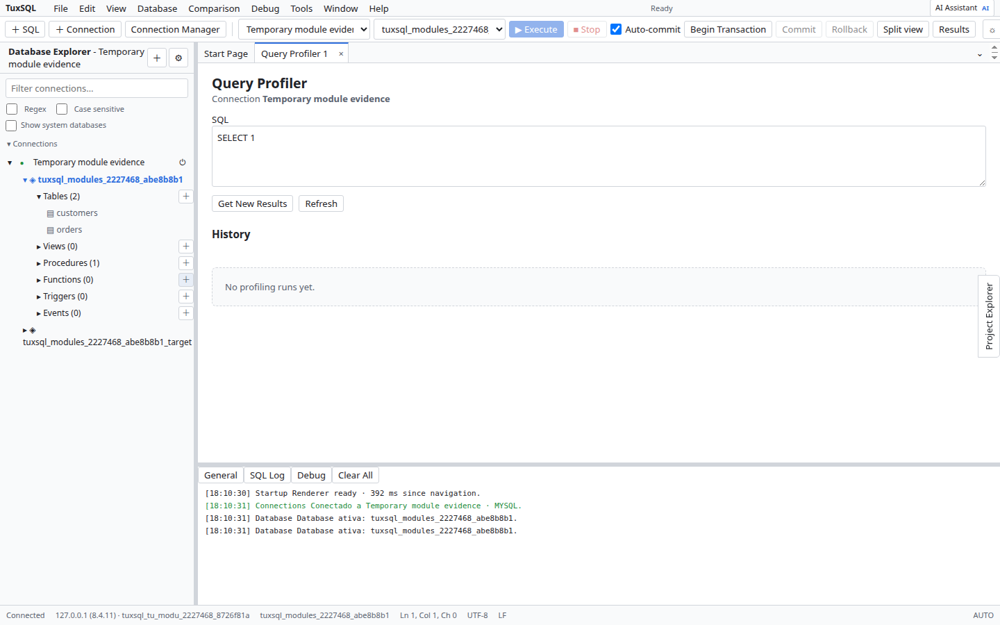 | 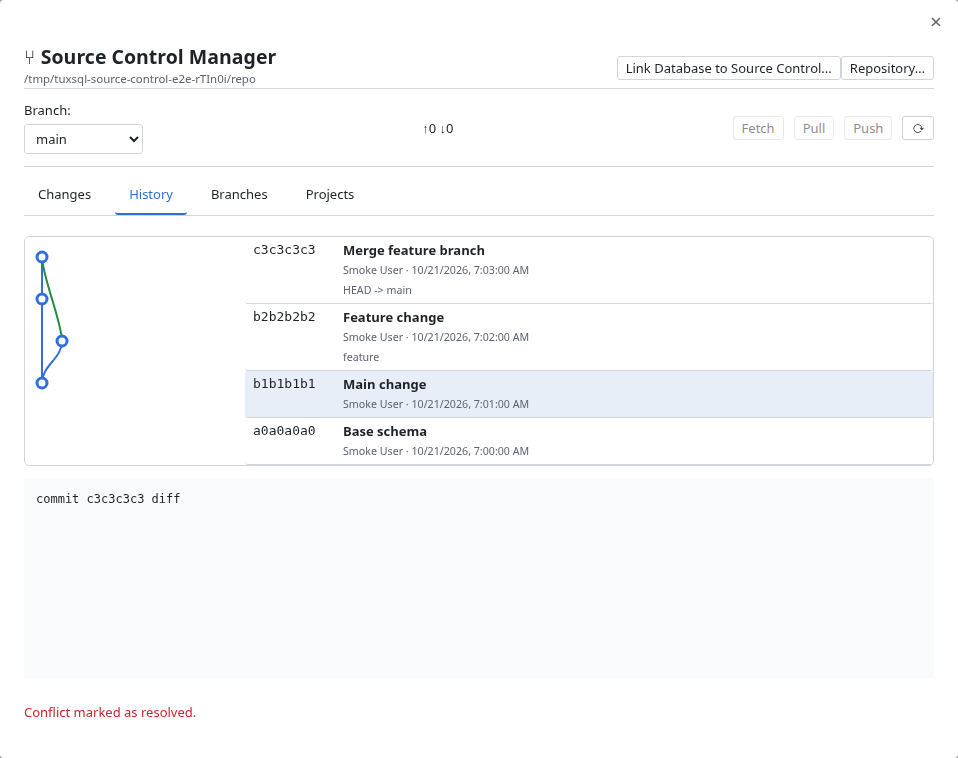 |
| 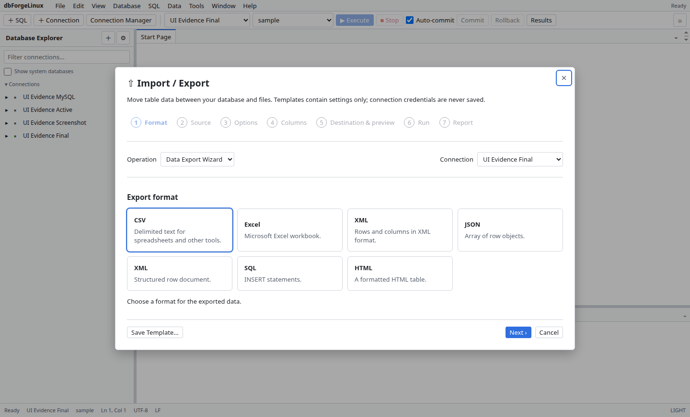 | 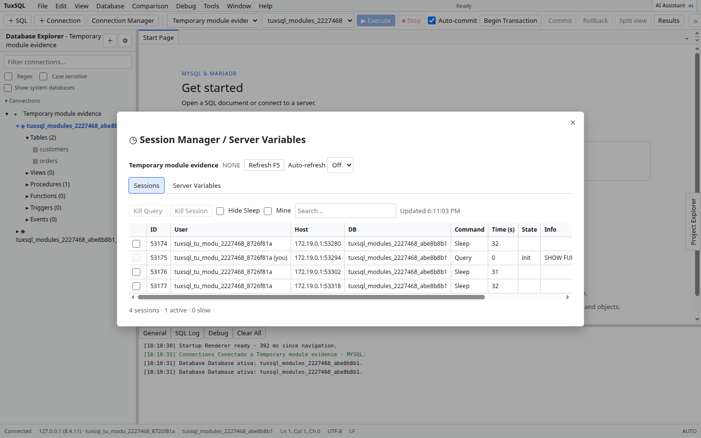 |

Mais de 200 capturas, em claro e escuro, estão em [`document/evidence/ui/`](document/evidence/ui/).

</details>

<br>

## Tudo o que vem incluído

<table>
  <tr>
    <td width="33%" valign="top">
      <h4>✍️ Editor e dados</h4>
      Editor SQL (Monaco) · autocomplete contextual · snippets · formatador · histórico · Database Explorer com filtro · grade virtualizada com spool em disco · edição inline · Master-Detail · Card View · Data Viewer · Table Designer · editores de View, Procedure, Function, Trigger e Event · Code Analysis
    </td>
    <td width="33%" valign="top">
      <h4>🔄 Comparar e mover</h4>
      Schema Compare · Data Compare · Import/Export em CSV, Excel (.xlsx), XML, JSON, HTML e SQL · ZIP protegido por senha (AES-256) · templates de exportação · Backup e Restore · Copy Databases · Execute Large Script · Source Control (Git) e Projects
    </td>
    <td width="33%" valign="top">
      <h4>🧪 Modelar e analisar</h4>
      Query Builder · Diagrama ER (.dbd) · Data Generator (.dgen) · Documenter (.ddoc) em HTML, Markdown e PDF · Data Report e Pivot com gráficos · Chart Designer · Query Profiler com EXPLAIN · Routine Debugger
    </td>
  </tr>
  <tr>
    <td width="33%" valign="top">
      <h4>🛠️ Administração</h4>
      Security Manager (usuários, hosts, privilégios, limites) · Session Manager (<code>KILL QUERY</code>/<code>KILL CONNECTION</code>) · Server Variables · Service Control via <code>systemd</code> · Table Maintenance · Find Object · Find Invalid Objects
    </td>
    <td width="33%" valign="top">
      <h4>🌐 Conectividade</h4>
      MySQL 5.7, 8.0 e 8.4 · MariaDB 10.11 e 11.x · TLS · túnel SSH com chave e passphrase · túnel HTTP (<code>tunnel.php</code>) · senhas no chaveiro do sistema
    </td>
    <td width="33%" valign="top">
      <h4>🎨 Ambiente</h4>
      Shell MDI com painéis acopláveis · temas Auto, Claro, Escuro e Alto Contraste · atalhos remapeáveis · interface em inglês e português do Brasil · documentação offline · atualização automática pelas Releases
    </td>
  </tr>
</table>

<br>

## Segurança em primeiro lugar

O TuxSQL lida com bancos reais, então a segurança é parte do projeto, não um extra:

- **IPC Guard central** (`app/src/main/ipc/guard.ts`): toda chamada entre a interface e o processo principal é validada contra schemas estritos; payloads malformados ou frames de origem desconhecida são rejeitados.
- **Nada destrutivo em silêncio:** `DROP`, `KILL`, restore, sincronizações e resets pedem confirmação explícita.
- **Credenciais protegidas:** senhas ficam no `libsecret`; sem ele, num cofre local cifrado com AES-256-GCM e aviso visível. Nunca em texto puro, nunca em logs.
- **IA com limites:** provedores remotos só por HTTPS, e linhas de tabela nunca saem sem o seu consentimento.

Relatórios: [revisão de segurança](document/security-review.md), [modelo de ameaças](document/security-threat-model.md), [hardening no Linux](document/security-linux-hardening.md) e [matriz por ferramenta](document/security-tools-matrix.md).

## Por dentro

- **Electron do jeito recomendado:** context isolation, preload com API tipada (`window.tuxsql`) e renderer sem acesso direto ao Node.
- **Domínio separado da interface:** a lógica (schema, editor, query builder, debugger, import/export, edição de grade e outros) fica em `app/src/modules/`, pura e testável sem Electron.
- **Feito para volume:** resultados em spool de disco, grade virtualizada e streaming do driver `mysql2`.
- **Implementação própria:** escrita a partir de especificações do projeto e de comportamento observado. Nenhum código, binário ou recurso do produto de referência.
- **Testado:** mais de 900 testes (unitários, contrato de IPC, estresse de streaming e integração), além de smoke E2E com Playwright contra o pacote instalado.

<details>
<summary><b>Estrutura do código</b></summary>

```
├── app/src/main/               # Processo principal (Node.js)
│   ├── db/                     # Drivers de conexão (pool mysql2, streaming, túneis SSH/HTTP)
│   ├── connections/            # Armazenamento e ciclo de vida de conexões
│   ├── security/               # PasswordVault (libsecret + AES-256-GCM) e WindowPolicy
│   ├── ipc/                    # Handlers IPC com validação de schemas e IPC Guard
│   └── index.ts                # Janela principal e ciclo de vida do Electron
│
├── app/src/preload/            # Pré-carregamento (context isolation)
│   ├── api/                    # APIs tipadas expostas ao renderer
│   └── index.ts                # contextBridge.exposeInMainWorld('tuxsql', ...)
│
├── app/src/renderer/           # Interface (React 19 + Monaco)
│   ├── src/ui/                 # Shell, painéis MDI, diálogos e componentes
│   ├── src/i18n/               # Internacionalização (en / pt-BR)
│   └── src/main.tsx            # Ponto de entrada React
│
└── app/src/modules/            # Módulos de domínio puros e testáveis
    ├── schema/                 # Introspecção, DDL e comparação de schemas
    ├── editor/                 # Autocomplete, snippets e formatação SQL
    ├── query-builder/          # Modelo visual e compilação para SQL
    ├── routine-debugger/       # Instrumentação para depuração passo a passo
    ├── ai-assistant/           # Cliente de IA, sanitização de contexto e streaming
    ├── data-export-import/     # Encoders e decoders (CSV, Excel, XML, JSON)
    ├── grid-editing/           # Deltas e geração de DML da grade
    └── ...                     # data-compare, er-diagram, profiler, security e outros
```

</details>

---

## Download

**Novo no TuxSQL?** Baixe o instalador pronto na página de **[Releases](https://github.com/danilosong/TuxSQL/releases/latest)**, sem precisar compilar. As [releases anteriores](https://github.com/danilosong/TuxSQL/releases) têm as versões antigas e suas notas.

| Formato | Para quem | Como usar |
| --- | --- | --- |
| `tuxsql_<versão>_amd64.deb` | Ubuntu, Debian, Linux Mint, Pop!_OS | `sudo apt install ./tuxsql_<versão>_amd64.deb` |
| `tuxsql_<versão>_x86_64.AppImage` | Qualquer distribuição Linux x86_64, sem instalar | `chmod +x tuxsql_*.AppImage && ./tuxsql_*.AppImage` |

Confira a integridade com o `SHA256SUMS.txt` da release:

```bash
sha256sum -c SHA256SUMS.txt --ignore-missing
```

Os binários são gerados pelo GitHub Actions a partir de uma tag `v*`; ficam nas Releases, não dentro do repositório.

### Compatibilidade de distribuições

A coluna **Situação** separa o que foi **verificado de verdade** do que é apenas **esperado**. Não declaramos suporte sem teste.

| Distribuição | Formato | Situação |
|---|---|---|
| Ubuntu 24.04 LTS | `.deb` | ✅ **Testada:** instalação limpa em contêiner (`dpkg -c`, `ldd`, início sob Xvfb) e smoke e2e contra o pacote |
| Ubuntu 26.04 | `.deb` e código-fonte | ✅ **Testada:** ambiente de desenvolvimento (uso diário do app) |
| Ubuntu 22.04 LTS, Debian 12+, Linux Mint 21+, Pop!_OS 22.04+, elementary OS 7+ | `.deb` | 🟡 **Esperada:** mesma família e mesmas dependências; ainda sem teste dedicado |
| Fedora, openSUSE, Arch Linux, Manjaro e outras | AppImage ou código-fonte | 🟡 **Esperada:** sem `.deb`; use o AppImage da release ou `pnpm dev`; ainda sem teste dedicado |
| Ubuntu 20.04 e anteriores, Debian 11 e anteriores | — | ❌ **Não verificada:** o Electron 38 exige uma glibc mais recente; provavelmente não funciona |

- **Arquitetura:** somente `amd64` por enquanto (sem pacotes ARM).
- **Servidor gráfico:** X11 e Wayland.
- **Dependências do `.deb`:** `libgtk-3-0`, `libnotify4`, `libnss3`, `libxss1`, `libxtst6`, `xdg-utils`, `libatspi2.0-0`, `libuuid1`, `libsecret-1-0`, `libasound2t64` ou `libasound2`, `libgbm1`.
- **Snap e Flatpak:** não são fornecidos.
- Testou em outra distribuição? Abra uma issue com a distro, a versão e o resultado; ela passa para a tabela acima.

### Compatibilidade de banco de dados

Verificada com testes de integração contra servidores reais em contêineres descartáveis:

| Servidor | Versão validada | Suíte de integração |
|---|---|---|
| **MySQL** | `5.7.44` | ✓ aprovada |
| **MySQL** | `8.0.46` | ✓ aprovada |
| **MySQL LTS** | `8.4.11` | ✓ aprovada |
| **MariaDB LTS** | `10.11.19` | ✓ aprovada |
| **MariaDB** | `11.8.9` | ✓ aprovada |

Handshakes TLS, fallbacks e diferenças por versão estão em [document/compat.md](document/compat.md).

## Primeiros passos

Depois de instalar o `.deb`, o TuxSQL aparece no menu do sistema. Pelo terminal:

```bash
tuxsql                          # abre o app
tuxsql ~/queries/analise.sql    # abre um arquivo SQL direto no editor
```

### A partir do código-fonte

Requisitos: **Node.js 22+**, **pnpm 10+** e **Git**.

```bash
git clone https://github.com/danilosong/TuxSQL.git
cd TuxSQL/app
corepack enable
pnpm install --frozen-lockfile
pnpm dev                        # modo desenvolvimento com hot-reload
```

Sem monitor (CI ou servidor remoto):

```bash
env -u DISPLAY -u WAYLAND_DISPLAY -u XDG_SESSION_TYPE xvfb-run -a pnpm dev
```

**Novos contribuidores:** comecem pelo [CONTRIBUTING.md](CONTRIBUTING.md) e pelo [Guia do Usuário](document/user-guide/README.md).

## Testes

Tudo roda a partir de `app/`:

```bash
pnpm typecheck        # tipos (TypeScript)
pnpm lint             # estilo (ESLint)
pnpm test             # testes unitários (Vitest)
pnpm perf:benchmark   # benchmark de spool e parsing
pnpm build            # build de produção
pnpm dist:deb         # pacote Debian (.deb)
```

Integração contra MySQL 8.4 e MariaDB 11 descartáveis:

```bash
docker compose -f test/docker-compose.yml up -d --wait
MYSQL_INTEGRATION=1 pnpm test
pnpm smoke:e2e        # Playwright + Electron sob Xvfb
docker compose -f test/docker-compose.yml down -v
```

## Estado do projeto

> [!IMPORTANT]
> **O TuxSQL está em alpha, e queremos ser diretos sobre isso.** Os 20 módulos do inventário estão implementados, com testes e evidências visuais, mas o projeto ainda é jovem: espere arestas. **Não afirmamos paridade certificada com nenhum produto comercial**, em especial o dbForge Studio for MySQL, que serviu apenas como referência da *categoria* de funcionalidades. Os desvios conhecidos estão na [Matriz de Paridade](document/03-matriz-paridade.md) e o que ficou fora do escopo está em [`document/paridade/ESCOPO-LINUX.md`](document/paridade/ESCOPO-LINUX.md). Encontrou um problema? [Abra uma issue](https://github.com/danilosong/TuxSQL/issues) com a distro, a versão do servidor e, se possível, uma captura.

### Limitações conhecidas

1. **Depurador de rotinas:** funciona só com **stored procedures**, por instrumentação temporária e variáveis de sessão. Não depura stored functions, triggers nem `PREPARE/EXECUTE` dinâmico.
2. **Edição na grade:** só em consultas sobre uma única tabela com **chave primária ou índice UNIQUE**. Consultas com `JOIN`, subconsultas, `GROUP BY` ou colunas calculadas ficam somente leitura.
3. **Fora de escopo:** recursos legados de Windows (Microsoft Access direto, ODBC de 32 bits, conectores Google Sheets antigos, TFS e Mercurial) não fazem parte do projeto.

## Documentação

| | |
|---|---|
| 📘 [Guia do Usuário por módulo](document/user-guide/README.md) | 🗺️ [Matriz de Paridade](document/03-matriz-paridade.md) |
| 🔐 [Revisão de Segurança](document/security-review.md) | 🐬 [Compatibilidade MySQL/MariaDB](document/compat.md) |
| 🐧 [Notas de Linux](document/linux.md) | ⚡ [Desempenho](document/perf.md) |
| 🤝 [Como Contribuir](CONTRIBUTING.md) | 📝 [Changelog](CHANGELOG.md) |
| ⚖️ [Aviso Legal](LEGAL.md) | 📦 [Licenças de terceiros](THIRD-PARTY.md) |

---

## Aviso Legal (Disclaimer)

**TuxSQL** é um software livre de código aberto (licença MIT) e de desenvolvimento independente, criado por **Danilo Song** e mantido pela comunidade.

- **Não é um clone.** É uma implementação independente, para Linux, de funcionalidades comuns a IDEs de banco de dados. Funcionalidades, ideias, métodos e algoritmos não são protegidos por direito autoral; a *expressão* (código, imagens, textos, identidade visual) é, e **nada disso foi copiado** (Lei nº 9.609/1998, art. 2º e art. 6º, III; Lei nº 9.610/1998, art. 8º).
- Este projeto **não é afiliado, associado, autorizado, patrocinado ou de qualquer forma oficialmente conectado à Devart** ou a qualquer uma de suas subsidiárias ou afiliadas.
- O código-fonte, componentes, folhas de estilo e recursos visuais deste repositório foram criados do zero para este projeto; **nenhum código-fonte proprietário, biblioteca fechada, binário, ícone, imagem ou texto de ajuda pertencente ao dbForge Studio foi copiado ou incluído neste repositório**. Materiais extraídos de outros produtos não são versionados nem distribuídos.
- As capturas de tela deste README mostram **exclusivamente o TuxSQL**.
- *dbForge*, *dbForge Studio* e *Devart* são marcas de seus legítimos titulares, sem qualquer direito reivindicado aqui. Aparecem apenas de forma **nominativa e descritiva** (Lei nº 9.279/1996, art. 132), para informar a relação de equivalência de funcionalidades e a ausência de vínculo.
- **Titulares de direitos:** se achar que algo aqui viola seus direitos, abra uma issue ou contate o mantenedor; o conteúdo será analisado e, havendo fundamento, removido ou substituído, inclusive com renomeação do projeto. Detalhes em [LEGAL.md](LEGAL.md).
- Este texto não é aconselhamento jurídico. O software é fornecido "como está", sem garantias (veja o [`LICENSE`](LICENSE)).

*English:* TuxSQL is an independent MIT-licensed project. It is not a clone or derivative of dbForge Studio, contains none of its code or assets, and is not affiliated with, sponsored or endorsed by Devart. Trademarks belong to their owners and are mentioned only descriptively. Rights holders may contact the maintainer to request review or removal (see [LEGAL.md](LEGAL.md)).

<sub>MySQL é marca registrada da Oracle Corporation; MariaDB é marca registrada da MariaDB plc; Linux é marca registrada de Linus Torvalds. O TuxSQL não é afiliado a nenhuma delas; os nomes aparecem apenas para descrever compatibilidade.</sub>

---

<p align="center">
  <br>
  <sub>Desenvolvido com dedicação para a comunidade de desenvolvedores e administradores de banco de dados Linux.</sub><br>
  <sub><a href="https://github.com/danilosong/TuxSQL/issues">Issues</a> · <a href="https://github.com/danilosong/TuxSQL/releases">Releases</a> · <a href="CONTRIBUTING.md">Contribuir</a></sub>
</p>

## Histórico de estrelas

[](https://www.star-history.com/#danilosong/TuxSQL&Date)
