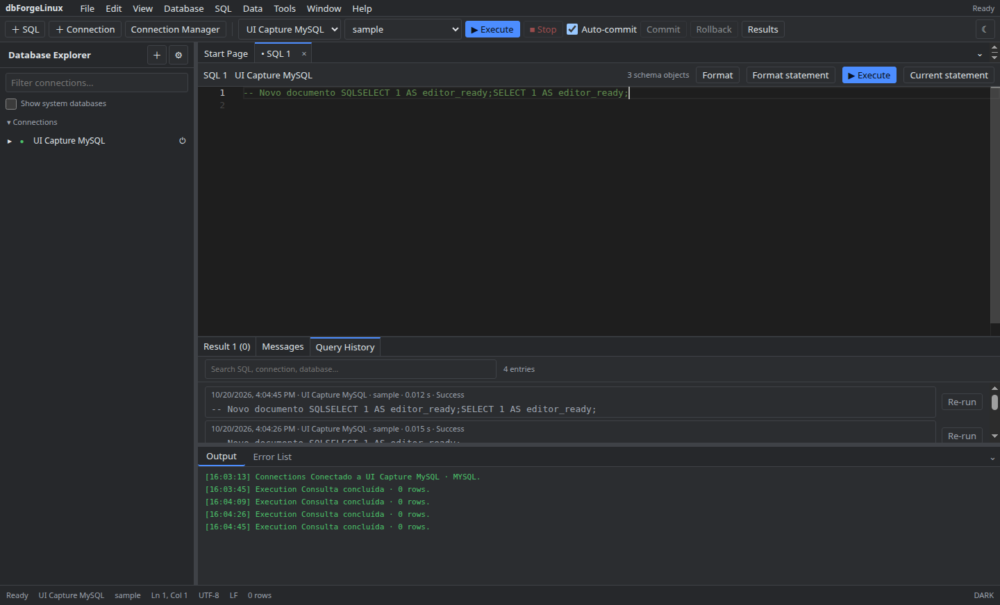

# Autocomplete, snippets e histórico

No editor SQL, digite para receber sugestões baseadas no contexto e nos metadados carregados do schema. Use aliases nas consultas para melhorar as sugestões de colunas e atualize os metadados depois de mudanças externas.

Use os comandos de formatação para formatar o documento, a seleção ou a instrução. O painel **Query History** permite buscar execuções anteriores e reexecutar o SQL selecionado. Histórico não deve conter credenciais embutidas na consulta.

