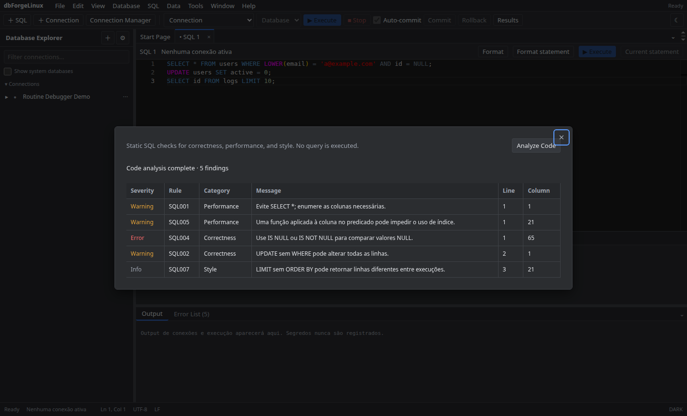
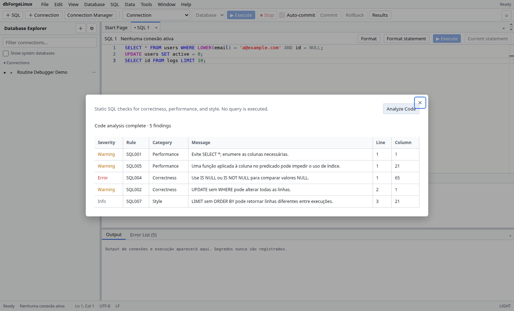

# Code Analysis

No editor SQL, abra **Code Analysis** para analisar o documento atual. A lista mostra avisos estáticos como `SELECT *`, escrita sem `WHERE` e funções sobre colunas indexadas, com indicação para revisar o trecho.

Os avisos são heurísticas locais: revise o SQL e o plano do servidor antes de mudar uma consulta. Veja ou feche a lista de erros sem perder o documento.

