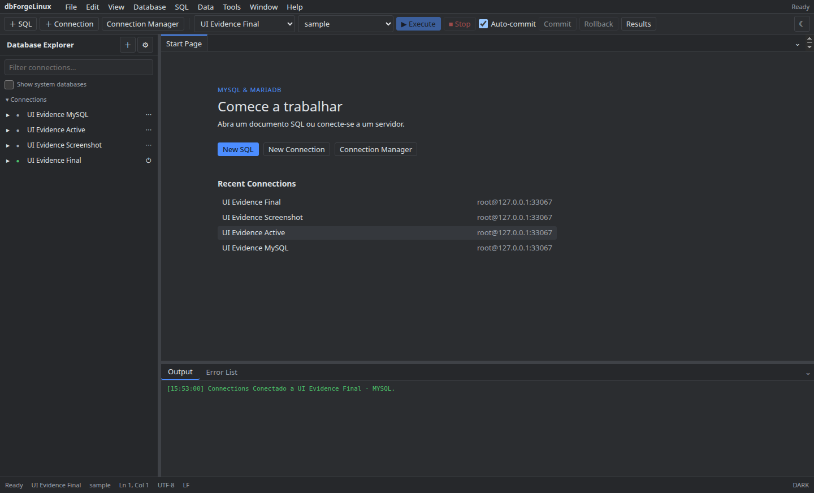

# Conexões

1. Na tela inicial, escolha **New Connection** e informe um nome, host, porta, usuário e database opcional.
2. Use **Test Connection** para conferir o acesso e salve a configuração.
3. Para TLS, SSH ou HTTP Tunnel, abra as opções avançadas da conexão e preencha os campos necessários. Segredos são guardados pelo cofre do app.
4. Selecione **Connect** para abrir o Explorer. Para remover uma conexão, use sua ação no painel lateral.

Use `127.0.0.1` e a porta publicada quando o banco estiver em container local. Consulte [Linux](../linux.md) para comportamento do keyring.

