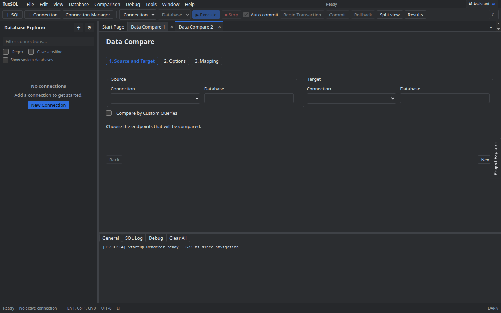
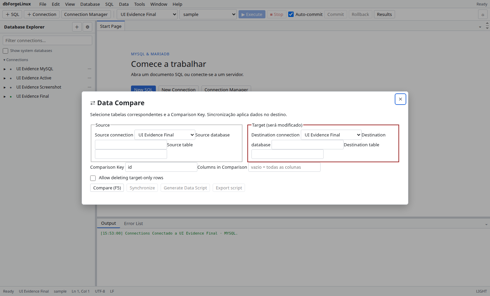

# Data Compare

1. Abra **Data Compare** e selecione as conexões, databases e tabelas de origem e destino.
2. Escolha as colunas-chave e os campos que serão comparados.
3. Revise diferenças e o preview da sincronização. Confirme antes de gravar mudanças no destino.

Confira a direção da cópia com cuidado: sincronizar pode inserir, atualizar ou remover linhas conforme as opções escolhidas.

