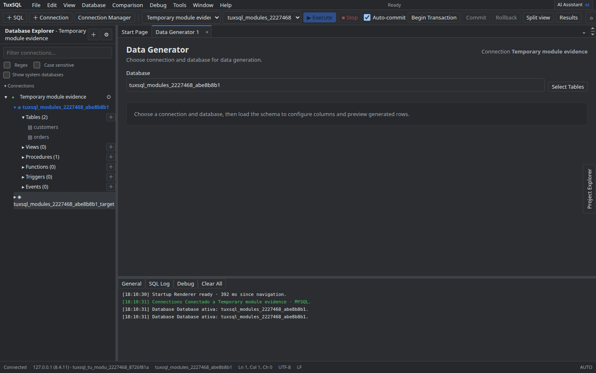

# Data Generator

Selecione conexão, database e tabela. Configure quantidade de linhas e geradores por coluna; use **Preview** para revisar uma amostra. **Generate** grava os dados e pede confirmação.

Confira constraints, foreign keys e os efeitos sobre o database antes de iniciar uma geração em volume.

