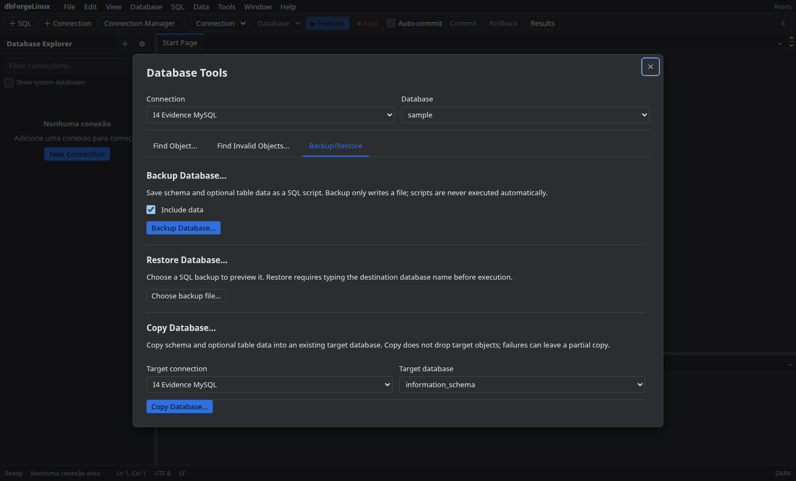
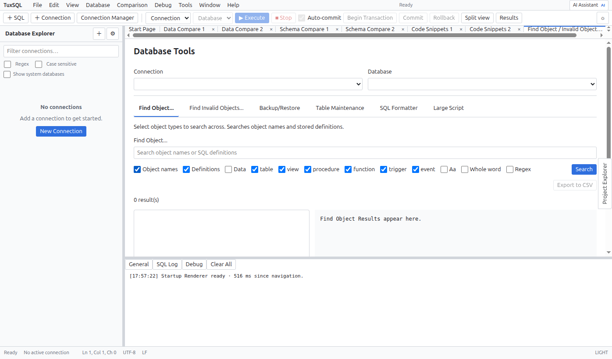

# Database Tools

Abra **Database Tools** no menu Tools. A busca de objetos recebe conexão, database e critérios; use **Invalid Objects** para localizar objetos inválidos. Backup, restore e cópia pedem database e opções antes de executar.

Revise origem, destino e script de restore antes de confirmar. Faça backup independente quando a operação puder substituir dados.

