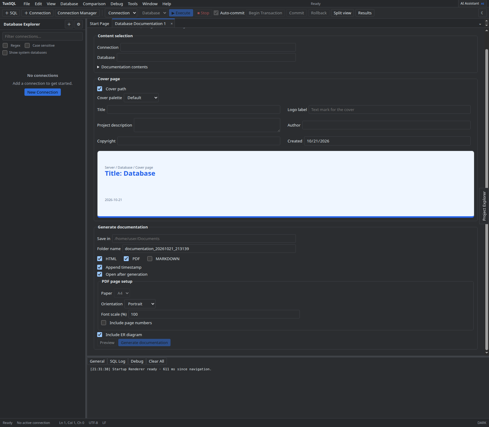
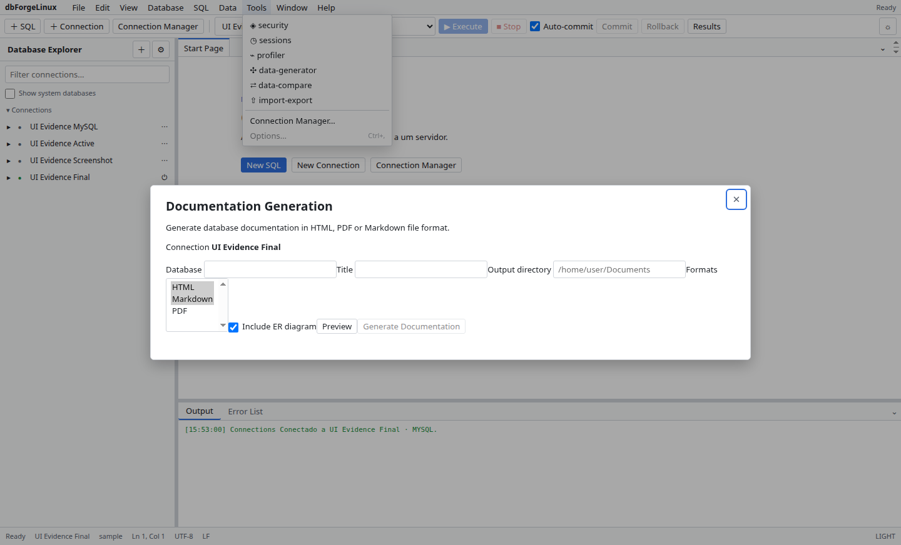

# Documenter

Selecione conexão e database e gere uma prévia da documentação. Configure título, descrições, conteúdo e formato; escolha uma pasta de destino e confirme a geração.

Confira o destino e os objetos incluídos. Formatos e opções variam conforme os recursos instalados.

