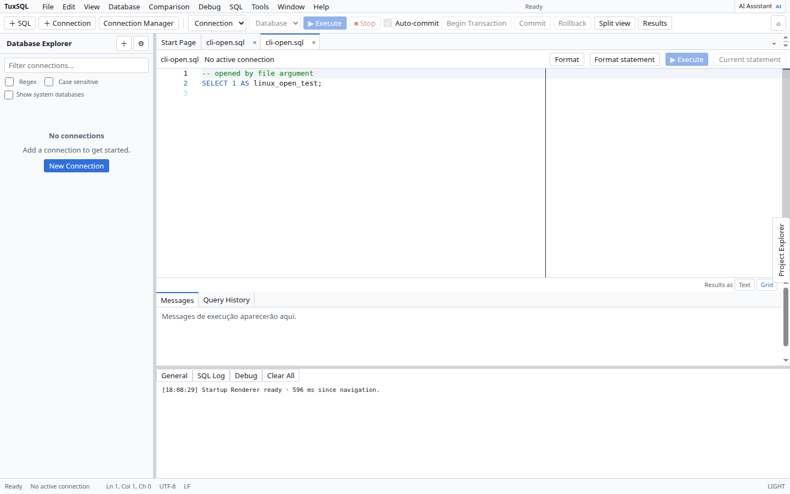

# Database Explorer

1. Conecte-se a um servidor e selecione o database no Explorer.
2. Expanda Tables, Views, Routines ou Triggers para listar os objetos disponíveis.
3. Abra um objeto pelo menu de contexto para inspecionar seu DDL ou iniciar **Design/Edit** quando o tipo for suportado.
4. Atualize a árvore após alterações feitas fora do app.

O menu e a profundidade de operações variam conforme o tipo de objeto e os privilégios da conta. Veja [editores de objetos](object-editors.md).

