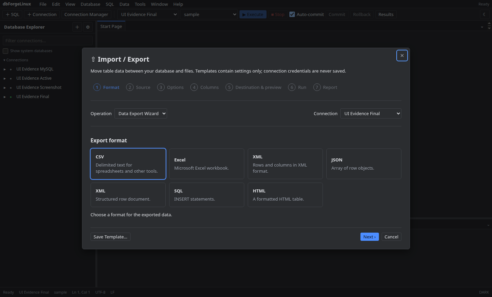

# Importação e exportação

Abra **Import/Export** pelo menu de ferramentas. Para exportar, selecione conexão, consulta, formato e destino. Para importar, escolha arquivo, tabela e modo de escrita; confira a prévia e as colunas mapeadas antes de confirmar.

Cancelar interrompe tarefas em andamento quando o formato permite. Tamanho, formato e opções aceitas estão sujeitos aos limites documentados na matriz.

