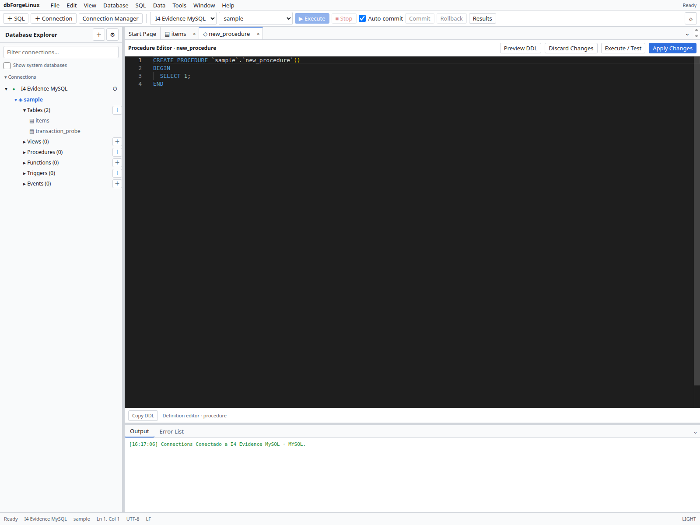

# Table Designer e editores de objetos

No Explorer, abra o menu de contexto de uma tabela e escolha **Design**. Edite colunas, tipos, chaves, índices e relações suportadas; confira o preview DDL antes de aplicar.

Para views, rotinas, triggers e events, escolha **Edit**, revise o template e inspecione o DDL. Alterações ou remoções pedem confirmação no fluxo. As opções aceitas dependem do tipo do objeto e da versão do servidor.

