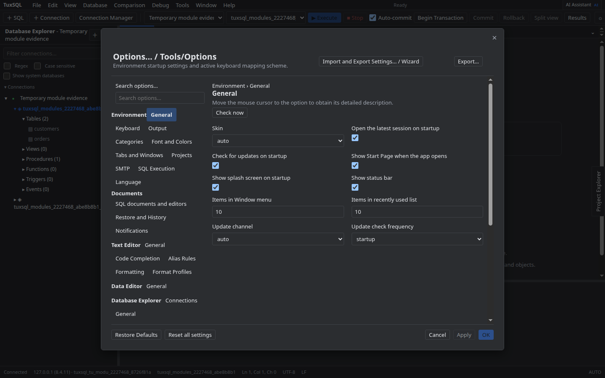
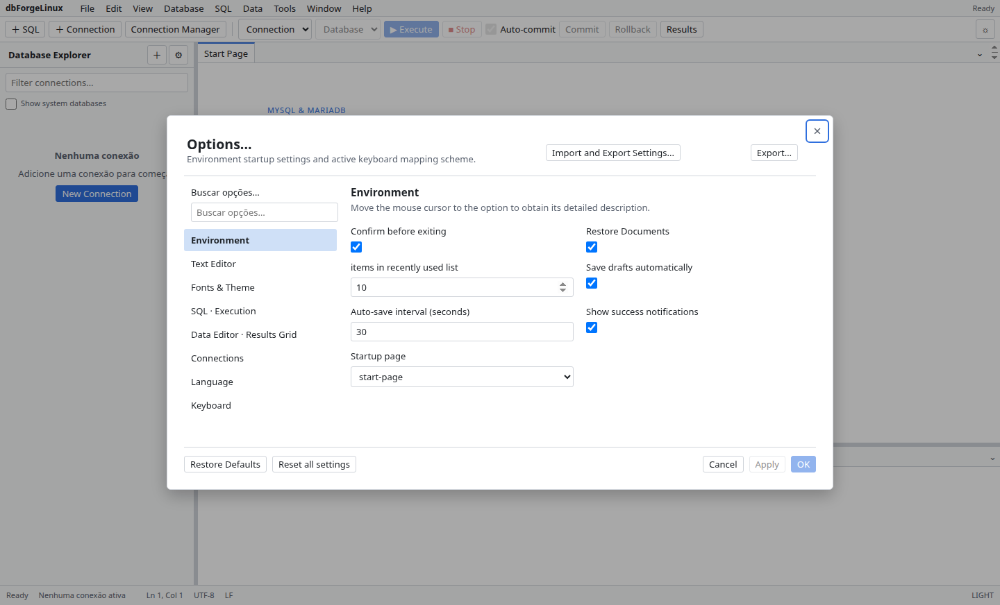

# Opções

Abra **Options** para ajustar preferências da aplicação. Alterações podem ser exportadas para backup ou importadas de um arquivo; revise o conteúdo e as opções resultantes antes de salvar.

Atalhos conflitantes são indicados para que você possa ajustar a combinação. Alguns ajustes visuais se aplicam após reabrir o painel ou a aplicação.

