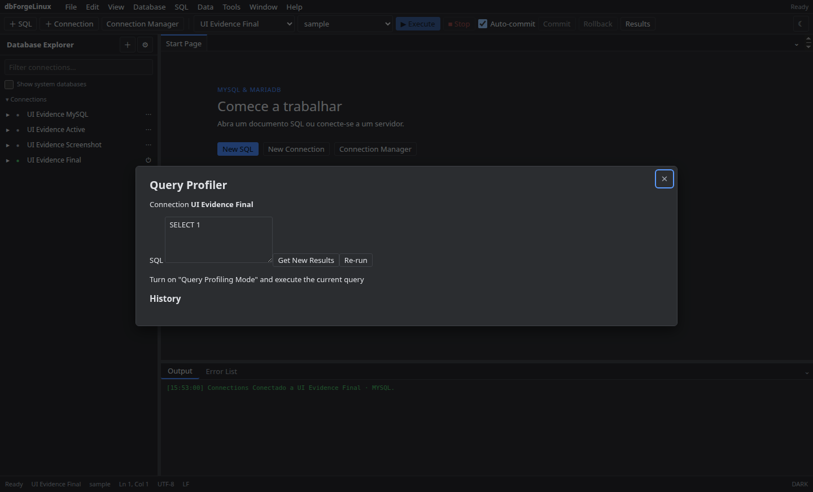

# Query Profiler

Escolha a conexão, informe uma consulta e solicite análise. O Profiler apresenta o plano e métricas disponíveis; consulte também a aba de histórico para revisar análises anteriores.

Use **EXPLAIN** para inspecionar o plano. Operações que executam a consulta podem consumir recursos ou alterar dados se o SQL for mutável; revise antes de iniciar.

