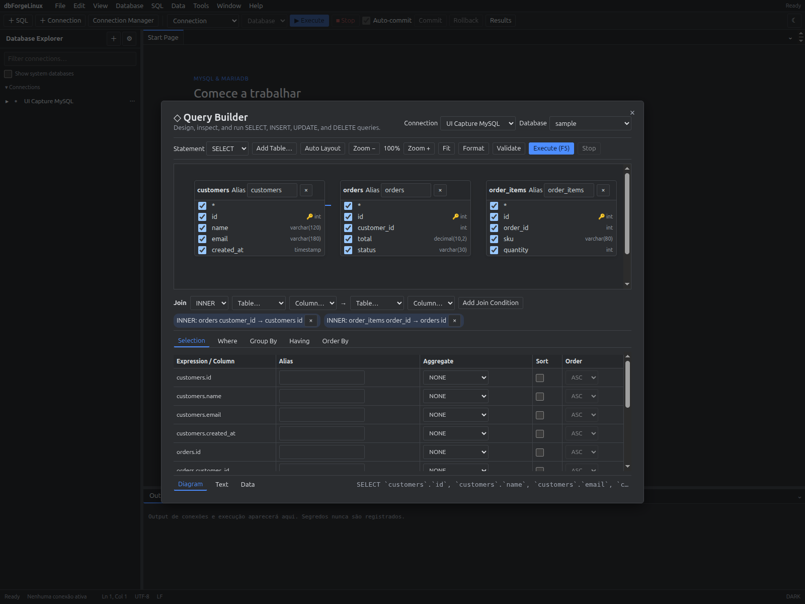
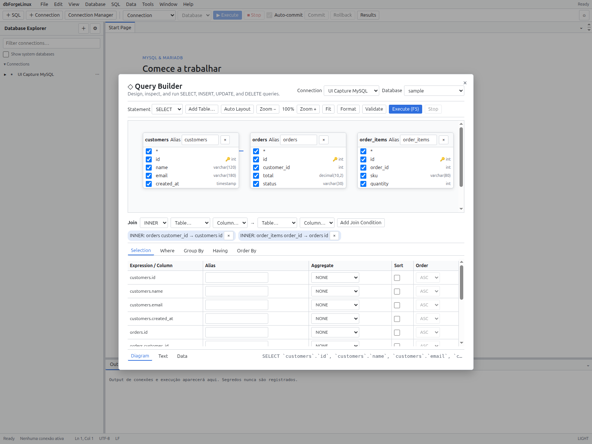

# Query Builder

Abra **Query Builder**, selecione a conexão e o database e adicione tabelas ao canvas. Escolha colunas, joins, filtros, agrupamento e ordenação; o preview apresenta o SQL gerado.

Revise o SQL e os parâmetros antes de executar. O builder cobre os formatos descritos na matriz de paridade; SQL complexo pode exigir edição manual.

