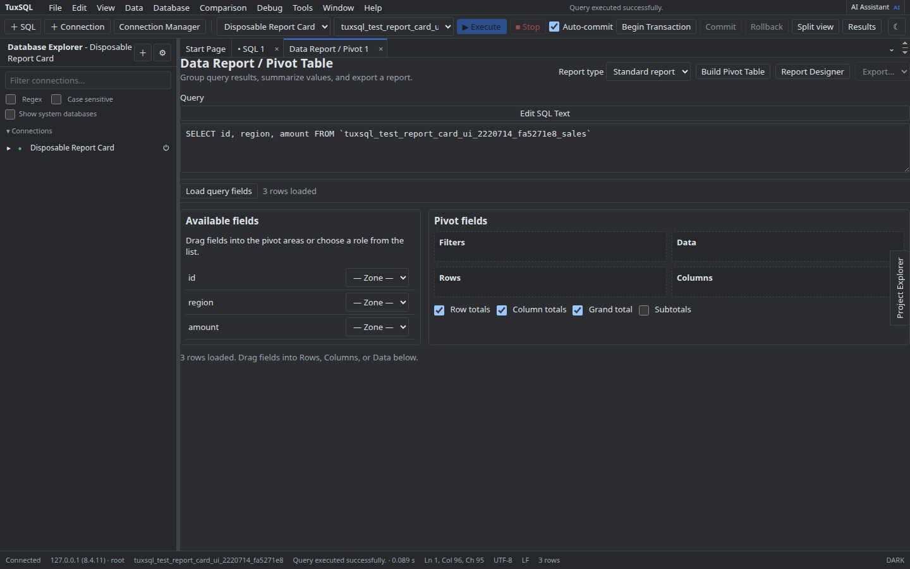

# Relatórios Pivot

Carregue um conjunto de dados a partir de uma consulta, configure dimensões e agregações e revise os resultados no designer. Ajuste filtros e ordenação antes de exportar para um formato disponível.

As agregações operam sobre os dados carregados; resultados grandes podem exigir uma consulta mais seletiva.

