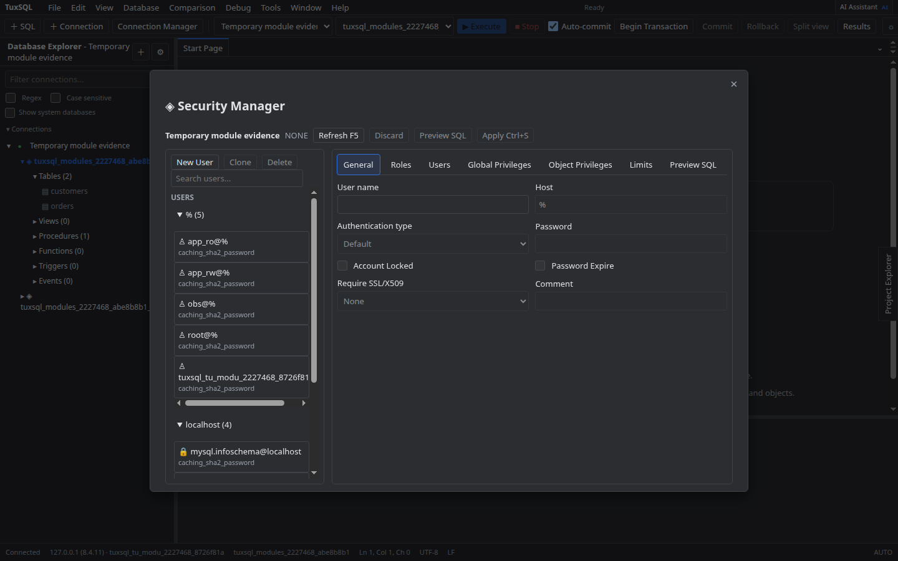
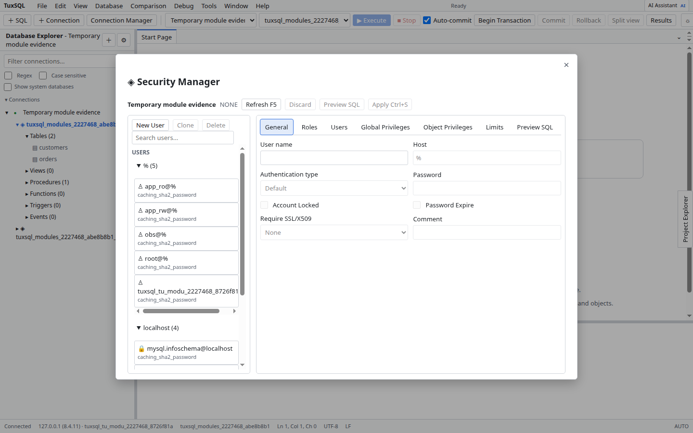

# Segurança

Abra **Security Manager**, escolha uma conexão e carregue as contas. Selecione uma conta para ver grants e privilégios; use a edição para preparar alterações e revisar o preview SQL.

Aplicar exige confirmação explícita e privilégios suficientes no servidor. Mudanças de usuário e grants podem afetar acessos em produção; valide a conta e o escopo antes de confirmar.

