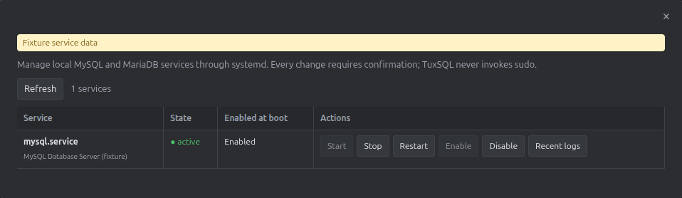
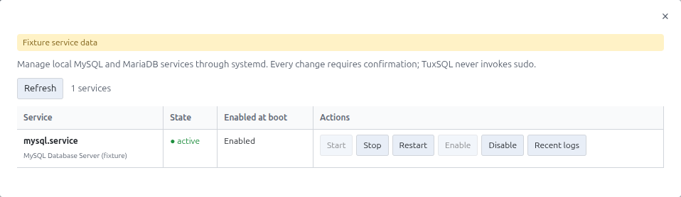

# Service Control

Abra **Service Control** para listar serviços MySQL/MariaDB detectados pelo `systemctl`. Escolha um serviço e uma ação disponível; ações que mudam o estado pedem confirmação.

O app não executa `sudo` automaticamente. Se o usuário atual não tiver permissão, o painel informa o comando que o administrador pode executar.

