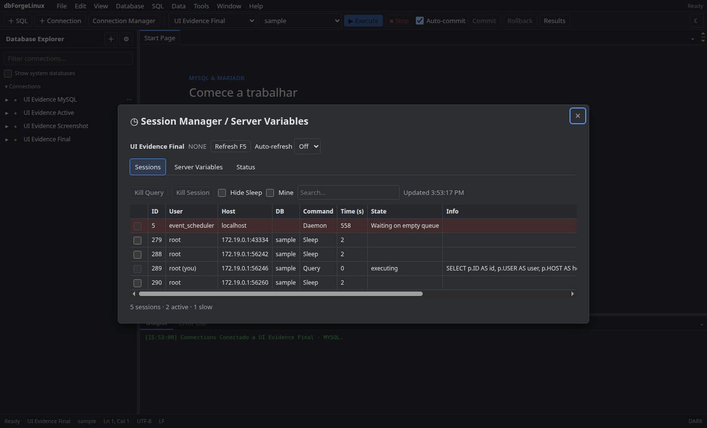

# Sessions

Abra **Sessions** e selecione uma conexão para listar sessões ativas. Use filtros e detalhes para inspecionar comandos e estado. **Kill** encerra uma sessão ou consulta após confirmação.

O servidor pode exigir privilégios administrativos para mostrar ou encerrar sessões. Confirme o ID antes de encerrar uma conexão de usuário.

